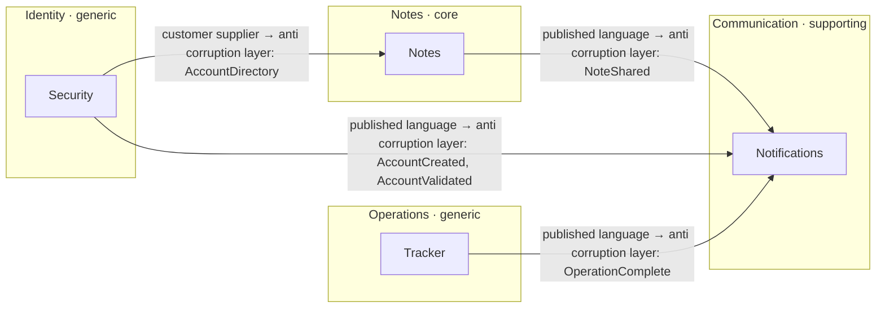

# Clean Architecture & DDD, a reference implementation

One small application — notes you can share, accounts, notifications, operation tracking — written to be **read**: every Domain-Driven Design and Clean Architecture concept appears exactly once, in the simplest form that still does its job, and the architectural rules are checked by tooling rather than by convention.

The reference is written in several programming languages from **one architecture**. The architecture is data, in [`conventions/`](conventions/README.md): the layers and what each may import, every rule under a stable id, the HTTP grammar, the vocabulary. Each language is a directory with its own toolchain, its own guide, and a **binding** that says where its trees are, which of its files shows each concept and which tool holds each rule. A language never carries a rule of its own; what it cannot show yet, the map below shows as a gap ([ADR 11](docs/adr/0011-one-reference-several-languages.md)).

- [Get started](#get-started)
- [The domain](#the-domain)
- [The languages](#the-languages)
- [The map: concept × language](#the-map-concept--language)
- [The rules, and how they are enforced](#the-rules-and-how-they-are-enforced)
- [How the repository is organised](#how-the-repository-is-organised)
- [Adding a language](#adding-a-language)
- [Decisions](#decisions)

## Get started

Ten minutes, three moves: run it, ask it, change it. Every command below runs from the directory it names: a language's from its directory, the tooling's from the root.

### Run it, in the language you read best

| Language | Needs | Run the server |
|---|---|---|
| TypeScript | Node ≥ 24 ([`.nvmrc`](typescript/.nvmrc)), yarn | `cd typescript && nvm use && yarn install && yarn start:dev` |
| Rust | a stable toolchain | `cd rust && cargo run -p bootstrap` |
| Python | Python ≥ 3.13, [uv](https://docs.astral.sh/uv/) | `cd python && uv sync && uv run python -m bootstrap` |
| Go | Go ≥ 1.24 | `cd go && go run ./bootstrap/cmd/application` |

Every server listens on `http://127.0.0.1:10000`, answers the API under `/v1` (`GET /v1/health` says it is up) and seeds one administrator, `admin@admin.fr` / `admin` (`ADMIN_IDENTIFIER`, `ADMIN_PASSWORD`). The four answer **one API**, and the proof is one command, against whichever server is up:

```bash
node api/scenario.mjs http://127.0.0.1:10000      # 31 steps: sign up, share a note, follow an operation, the websocket…
```

The front end is a static folder, a client like any other. Start the server with `WEB_ORIGINS=http://127.0.0.1:8080`, then:

```bash
node web/serve.mjs web/htmx --port 8080 --api http://127.0.0.1:10000   # then open http://127.0.0.1:8080
```

A language's README is where to read it: the request followed end to end, the map of its files, how it is tested.

### Ask it: the tooling answers from the data

The architecture, the domain and the storm are data, and one CLI answers from them (the [`clean-ddd`](tools/README.md) package at the root — `yarn install` once there; it reads every binding and answers in the language whose directory you type it from, `yarn --cwd .. architecture …` from `rust/`, or the one `--language go` names; add `--json` for a tool):

```bash
yarn install                                # once, at the root
yarn architecture domain                    # the subdomains and the context map, its contracts read from the code
yarn architecture context Notes             # one context: purpose, language, what it depends on, who depends on it
yarn architecture storm [Notes]             # the event storm read from the code (--markdown, --svg for the board)
yarn architecture inventory [rust]          # what the tree says the application is; with a language, where it differs
yarn architecture rule CTX-CONTRACTS        # any rule: statement, why, remediation, the file that shows it
yarn architecture concept aggregate-root    # any concept: canonical file, rules, decisions
yarn architecture checklist command         # what a new command is made of and where it goes, in this language
yarn architecture verb act                  # which HTTP verb and path shape an intent takes
yarn architecture can-import <file> <specifier>   # would this import be allowed, and which rule says
```

What the CLI prints is also rendered: [the domain](#the-domain) below, [the storm](docs/event-storm.md) with its board, [the inventory](docs/inventory/README.md) of each language.

### Change it: a feature, in the right shape

1. **Read the guide of the language**: [`typescript/CLAUDE.md`](typescript/CLAUDE.md), [`rust/CLAUDE.md`](rust/CLAUDE.md), [`python/CLAUDE.md`](python/CLAUDE.md) or [`go/CLAUDE.md`](go/CLAUDE.md), its *How to add a feature* and the questions it answers. Domain first, then the handler, infrastructure only if a port changed, the route, the wiring.
2. **Ask before writing**: `yarn architecture checklist <kind>` names the canonical file to copy; `can-import` checks a planned import; a cross-context feature runs between contexts the map relates (`yarn architecture domain`). A plan is optional and worth it when a feature crosses a context: [`conventions/plans/share-a-note.rust.yaml`](conventions/plans/share-a-note.rust.yaml) is the example, `yarn architecture plan validate|explain <file>` checks it. When the model itself is the question, hold the session first: the [`storm` skill](.claude/skills/storm/SKILL.md) facilitates it and writes what it decided as [`conventions/storms/<feature>.yaml`](conventions/storms/pin-a-note.yaml), in words every language shares; `yarn architecture storm --expect <file>` then says what the code still owes it, until nothing ([ADR 22](docs/adr/0022-the-storm-is-facilitated-and-the-code-is-held-to-it.md)).
3. **Prove it stayed inside the architecture**: `yarn architecture mode feature --base working` refuses a change to the building blocks, the shared kernel, the conventions or the decisions; then the language's checks, the same CI runs:

   | Language | The checks |
   |---|---|
   | TypeScript | `yarn check:conventions && yarn format:check && yarn lint && yarn typecheck && yarn test:units && yarn test:e2e` |
   | Rust | `cargo run -p conventions && cargo fmt --check && cargo clippy --all-targets -- -D warnings && cargo test` |
   | Python | `uv run python -m tools.conventions && uv run ruff format --check . && uv run ruff check . && uv run mypy && uv run pytest` |
   | Go | `go run ./tools/conventions && test -z "$(gofmt -l .)" && go vet ./... && golangci-lint run ./... && go test ./...` |

4. **Regenerate what the code renders**: the inventory of the language (`yarn conventions:write`, `cargo run -p conventions -- inventory --write`, `uv run python -m tools.conventions inventory --write`, `go run ./tools/conventions inventory --write`) and, at the root, `yarn conventions:write` for the storm and the documents; the check refuses a stale one. A feature that changes what a client sees fails the scenario against the other servers until they carry it: that is the list of what they owe ([ADR 16](docs/adr/0016-one-api-for-every-language.md)).

With an agent, the same loop is a procedure: the [`feature` skill](.claude/skills/feature/SKILL.md) asks the contract first and proves the change last, and the [`feature-author`](.claude/agents/feature-author.md) subagent is bound to the feature mode, told to stop and report rather than work around a rule.

### Change the architecture

A rule, a layer, a relationship between contexts, a binding, a language: that is a decision, made at the root under `yarn architecture mode architecture`, which asks for the ADR that explains it ([ADR 9](docs/adr/0009-work-is-done-in-one-of-two-modes.md)); then `yarn conventions:write` renders every language's documents and each language's check holds its tree to the change. The recipe for a language is [below](#adding-a-language).

## The domain

Before the layers: what the application is for, which parts of it are the business and which are commodity, and how the contexts talk. That is the strategic half of Domain-Driven Design, and here it is data too: [`conventions/domain.yaml`](conventions/domain.yaml) names the subdomains and their kind, each context's purpose and language, and the context map — every relationship between two contexts, with the pattern it follows, the mechanism that carries it and why. The contracts a relationship carries are read from the code, never written in the map, and `yarn check:conventions` holds the map to the code both ways: a relationship nothing carries, or a link the map does not declare, fails the build ([ADR 19](docs/adr/0019-the-domain-is-data.md)). Ask it from a terminal: `yarn architecture domain`, `yarn architecture context Notes`.

<!-- generated from conventions/domain.yaml (map); edit the YAML, then run the conventions check with --write -->
**Notes.** One small application written to be read: notes you can share with other accounts, which tells the people concerned and lets every caller follow what it asked for. The business is small on purpose; the point is the shape.

#### Subdomains

| Subdomain | Kind | Contexts | Why |
| --- | --- | --- | --- |
| Notes | core | Notes | Writing, sharing, archiving a note is what the application is for; its rules (who may edit, what an archived note refuses, who a note can be shared with) are the ones worth modelling and the ones a feature is most likely to touch. |
| Identity | generic | Security | Accounts, credentials, roles and signed tokens are what every application needs and no application competes on; the model here is the smallest that keeps the core honest about who is calling. |
| Communication | supporting | Notifications | Telling a person that something happened — a note shared with them, their account to validate, an operation completed — supports the core without being it; the channels are interchangeable and the notification has a lifecycle of its own. |
| Operations | generic | Tracker | Every command is accepted first and answered later; recording each operation and letting a client follow it to its outcome is plumbing any asynchronous application needs, and has no domain of its own. |

#### The context map

Upstream on the left, downstream on the right; the label is the pattern on each side, then the contracts the code carries.



| Upstream | Downstream | Patterns | Mechanism | Contracts (from the code) | Why |
| --- | --- | --- | --- | --- | --- |
| Notes | Notifications | published language, anti corruption layer | integration event | `NoteShared` | When a note is shared, the people it is shared with should hear of it. Notes publishes the fact in its public words and knows nothing of channels; Notifications restates it as a message for each recipient, which is its own business. |
| Security | Notifications | published language, anti corruption layer | integration event | `AccountCreated`, `AccountValidated` | A new account must receive its validation link, and a validated one a welcome; Security says what happened, Notifications decides what to send and how. |
| Tracker | Notifications | published language, anti corruption layer | integration event | `OperationComplete` | A caller answered 202 wants to know how its command went without polling; Tracker says an operation completed, Notifications pushes the outcome to the browser that asked. |
| Security | Notes | customer supplier, anti corruption layer | owned port | `AccountDirectory` | Sharing a note with an account that does not exist must be refused, and only Security knows which accounts exist. Notes asks in its own words, through a port it owns, and the adapter translates Security's read model into the one fact Notes needs. |

**Shared kernel.** An email address and the roles (who counts as an administrator, a user, a guest), who counts as signed in, and the integration events — the contracts between contexts, each in the public words of the context that publishes it. These are the words the whole application shares; a second definition of an email in each context would be four definitions to drift. The kernel holds vocabulary, not mechanics: the building blocks are not it.

#### The contexts and their language

<details>
<summary><b>Notes</b> (Notes) — The notes themselves: an account writes, edits, archives, restores and shares its notes, and reads its own and the ones shared with it.</summary>

| Term | Here it means |
| --- | --- |
| Note | the aggregate; a titled text owned by one account, active or archived, shared with zero or more accounts. |
| Owner | the account that wrote the note; the only one who may edit, archive, restore or share it. |
| Title | a value object; never blank, never longer than its maximum, trimmed. |
| Archived | the status of a note set aside; an archived note refuses an edit and a share until it is restored. |
| Sharing | the domain service that shares a note with an account, once it has asked whether that account exists. |
| Recipient | an account a note has been shared with, held by its id; what the note knows of it. |
| Suggestion | a title proposed from the content by a source outside the domain, which the note validates and may refuse. |

</details>
<details>
<summary><b>Security</b> (Identity) — Who is calling: accounts and their credentials, sign-up and its validation, login and the signed token every other request carries.</summary>

| Term | Here it means |
| --- | --- |
| Account | the aggregate; an email, a hashed password, a role and a status. |
| Pending | the status of an account that has signed up and not yet validated its email; it cannot sign in. |
| Validation | the step that turns a pending account active, through a token sent to its email. |
| Registration | the domain service that registers an account, once it has asked whether the email is free. |
| Credentials | an email and a password, checked against the hash; a wrong pair is one refusal, whichever half is wrong. |
| Signed token | what a signed-in caller carries; issued by Security, read by the authentication middleware on every request. |

</details>
<details>
<summary><b>Notifications</b> (Communication) — Telling a person something happened, over the channel that reaches them, and remembering whether it did.</summary>

| Term | Here it means |
| --- | --- |
| Notification | the aggregate; a message for one recipient, with the channels it goes out on and the attempts made. |
| Recipient | the account the message is for, known by its id and its email; what Security calls an account. |
| Channel | how a message reaches its recipient — email, or the websocket of a connected browser. |
| Delivery attempt | a child entity; one try on one channel, with its outcome, kept inside the notification. |
| Sent, Read, Failed | the lifecycle of a notification after it is created pending. |

</details>
<details>
<summary><b>Tracker</b> (Operations) — What became of each command: every operation the bus dispatches is recorded with its outcome, so that a caller answered 202 can follow it to success or refusal.</summary>

| Term | Here it means |
| --- | --- |
| Operation | one dispatch of one command or event, with its public name, its status and its result or error. |
| Outcome | how an operation ended — SUCCESS with its result, or ERROR with the refusal. |
| Trace | the id that ties an operation to the request that asked for it and to the operations it caused. |

</details>

#### Strategic design, where it is here

| Concept | Here | Notes |
| --- | --- | --- |
| Bounded context | `contexts` of [`domain.yaml`](conventions/domain.yaml): a purpose and a language each | a boundary inside which the words have one meaning and one model; here a directory with its four layers and its wiring file, declared in every binding |
| Subdomain | `subdomains` of [`domain.yaml`](conventions/domain.yaml), each with its kind and the reason for it | a part of the business, core (what the application is for, modelled with care), supporting (what the core needs and nobody competes on) or generic (what every application needs); the kind says where care goes |
| Ubiquitous language | `language` of each context in [`domain.yaml`](conventions/domain.yaml), rendered above | the words a context speaks, used in its code, its tests, its routes and its conversations alike; the same word in two contexts (an account, a recipient) is two words |
| Context map | `relationships` of [`domain.yaml`](conventions/domain.yaml), the diagram and the table above | every relationship between two contexts, upstream first, with the pattern on each side and the mechanism that carries it; the contracts it carries are read from the code, and the check holds the two to each other |
| Published language | the integration-event relationships of the map; [ADR 6](docs/adr/0006-integration-events-and-owned-ports-are-the-contracts-between-contexts.md) | the upstream publishes its facts in a contract written in its public words, for any consumer; here an integration event in the shared kernel, named for the fact (`NoteShared`) |
| Customer–supplier | the owned-port relationships of the map; [ADR 6](docs/adr/0006-integration-events-and-owned-ports-are-the-contracts-between-contexts.md) | the downstream is a customer with a question the upstream serves; here a port the asking context owns, in its own words, answered by an adapter over the other context's read model |
| Anti-corruption layer | the downstream side of every relationship of the map; the application row of the map below names the files | the downstream translates the upstream's model into its own at the boundary, so that a change upstream touches one file here; the handler of an integration event, the adapter of an owned port |
| Shared kernel | `sharedKernel` of [`domain.yaml`](conventions/domain.yaml) | what every context agrees on and changes together: vocabulary, not mechanics; declared once, not as a relationship between pairs |
<!-- end generated -->

What happens inside each context — who may ask for what, which command reaches which aggregate, which fact that records, who reacts — is the **event storm**, read from the code rather than drawn by hand: [`docs/event-storm.md`](docs/event-storm.md), with the board as one picture ([ADR 20](docs/adr/0020-the-event-storm-is-read-from-the-code.md)); `yarn architecture storm` from a terminal. The same reading, in words every language shares, is the **inventory** each language's tool writes from its own tree ([`docs/inventory/`](docs/inventory/README.md)): the check holds the four equal, so the languages are one application from the inside as the scenario makes them one API from the outside (ARCH-ONE-APPLICATION, [ADR 21](docs/adr/0021-one-application-every-language-writes-the-same-inventory.md)). And the storm runs forwards too: a session facilitated by the [`storm` skill](.claude/skills/storm/SKILL.md) writes what a feature will add as an **expected storm** ([`conventions/storms/`](conventions/storms/share-a-note.yaml)), and the code is held to it ([ADR 22](docs/adr/0022-the-storm-is-facilitated-and-the-code-is-held-to-it.md)).

## The languages

Each language's README is where to start reading it: the request followed end to end, the map of its files, how to run it. Its CLAUDE.md is the guide for working in it, by hand or with an agent. The four answer one API: [`api/scenario.mjs`](api/scenario.mjs), a black-box client, walks whichever server is up and passes against each ([ADR 16](docs/adr/0016-one-api-for-every-language.md)); the front end is a client like any other, served from [`web/`](web) by any static server ([ADR 17](docs/adr/0017-the-front-end-is-a-client-served-elsewhere.md)).

<!-- generated from conventions/concepts.yaml (languages); edit the YAML, then run the conventions check with --write -->
| Language | Where | Contexts | Concepts shown | Read |
| --- | --- | --- | --- | --- |
| TypeScript | [`typescript/`](typescript) | Notes, Security, Notifications, Tracker | 49 / 49 | [README](typescript/README.md), [CLAUDE.md](typescript/CLAUDE.md) |
| Rust | [`rust/`](rust) | Notes, Security, Notifications, Tracker | 49 / 49 | [README](rust/README.md), [CLAUDE.md](rust/CLAUDE.md) |
| Python | [`python/`](python) | Notes, Security, Tracker, Notifications | 49 / 49 | [README](python/README.md), [CLAUDE.md](python/CLAUDE.md) |
| Go | [`go/`](go) | Notes, Security, Tracker, Notifications | 49 / 49 | [README](go/README.md), [CLAUDE.md](go/CLAUDE.md) |
<!-- end generated -->

## The map: concept × language

One canonical example per concept and per language, rendered from [`conventions/concepts.yaml`](conventions/concepts.yaml) and each language's binding. A dash is a concept that language does not show yet. The notes are the concept's, the same in every language; what a language adds to them is in its own README.

<!-- generated from conventions/concepts.yaml (map); edit the YAML, then run the conventions check with --write -->
#### Domain layer

| Concept | TypeScript | Rust | Python | Go | Notes |
| --- | --- | --- | --- | --- | --- |
| Entity | [`Entity.ts`](typescript/src/Architecture/Domain/Entity.ts) | [`entity.rs`](rust/src/architecture/domain/src/entity.rs) | [`entity.py`](python/src/architecture/domain/entity.py) | [`entity.go`](go/architecture/domain/entity.go) | identity, `equals()` |
| Aggregate root | [`Note.ts`](typescript/src/Contexts/Notes/Domain/Note/Note.ts), [`AggregateRoot.ts`](typescript/src/Architecture/Domain/AggregateRoot.ts) | [`mod.rs`](rust/src/contexts/notes/domain/src/note/mod.rs), [`aggregate_root.rs`](rust/src/architecture/domain/src/aggregate_root.rs) | [`note.py`](python/src/contexts/notes/domain/note/note.py), [`aggregate_root.py`](python/src/architecture/domain/aggregate_root.py) | [`note.go`](go/contexts/notes/domain/note/note.go), [`aggregate_root.go`](go/architecture/domain/aggregate_root.go) | behaviours enforce invariants and `record()` events |
| **Entity inside an aggregate** (not a root) | [`DeliveryAttempt.ts`](typescript/src/Contexts/Notifications/Domain/Notification/DeliveryAttempt.ts) | [`delivery_attempt.rs`](rust/src/contexts/notifications/domain/src/notification/delivery_attempt.rs) | [`delivery_attempt.py`](python/src/contexts/notifications/domain/notification/delivery_attempt.py) | [`delivery_attempt.go`](go/contexts/notifications/domain/notification/delivery_attempt.go) | has its own identity, exists only inside `Notification`, reached and persisted through it. The criterion: few, consistent with the root in the same change, written through the root. What grows without bound or is written by others is its own aggregate (comments on a note) |
| Value object | [`NoteTitle.ts`](typescript/src/Contexts/Notes/Domain/Note/NoteTitle.ts), [`Email.ts`](typescript/src/SharedKernel/Domain/Email.ts), [`Credentials.ts`](typescript/src/Contexts/Security/Domain/Account/Credentials.ts) | [`note_title.rs`](rust/src/contexts/notes/domain/src/note/note_title.rs), [`email.rs`](rust/src/shared_kernel/domain/src/email.rs), [`credentials.rs`](rust/src/contexts/security/domain/src/account/credentials.rs) | [`note_title.py`](python/src/contexts/notes/domain/note/note_title.py), [`email.py`](python/src/shared_kernel/domain/email.py), [`delivery_strategy.py`](python/src/contexts/notifications/domain/notification/delivery_strategy.py) | [`note_title.go`](go/contexts/notes/domain/note/note_title.go), [`email.go`](go/sharedkernel/domain/email.go), [`delivery_strategy.go`](go/contexts/notifications/domain/notification/delivery_strategy.go) | built through `create()` → `Result`; never invalid once you hold one |
| Identity | [`Id.ts`](typescript/src/Architecture/Domain/Id.ts) | [`id.rs`](rust/src/architecture/domain/src/id.rs) | [`id.py`](python/src/architecture/domain/id.py) | [`id.go`](go/architecture/domain/id.go) | generated by the domain (`Id.generate()`), not by the database — [ADR 2](docs/adr/0002-identity-is-generated-by-the-domain.md) |
| Factory | [`Note.ts`](typescript/src/Contexts/Notes/Domain/Note/Note.ts) | [`mod.rs`](rust/src/contexts/notes/domain/src/note/mod.rs), [`account_registration.rs`](rust/src/contexts/security/domain/src/account/account_registration.rs) | [`note.py`](python/src/contexts/notes/domain/note/note.py), [`account_registration.py`](python/src/contexts/security/domain/account/account_registration.py) | [`note.go`](go/contexts/notes/domain/note/note.go), [`account_registration.go`](go/contexts/security/domain/account/account_registration.go) | the aggregate is its own factory: a static `create()` that validates, generates the identity and records the creation event; the constructor is private. When creation needs a collaborator (a port), the factory is a domain service. No `Factory` class |
| Invariant | [`Note.ts`](typescript/src/Contexts/Notes/Domain/Note/Note.ts) | [`mod.rs`](rust/src/contexts/notes/domain/src/note/mod.rs) | [`note.py`](python/src/contexts/notes/domain/note/note.py) | [`note.go`](go/contexts/notes/domain/note/note.go) | a rule that must hold after every change (only the owner, not archived, not twice, not with yourself): checked inside the behaviour, before the state changes and the event is recorded. There is no `validate()` to forget, and no way to reach the state but through the behaviour |
| Creation vs reconstitution | [`Note.ts`](typescript/src/Contexts/Notes/Domain/Note/Note.ts) | [`mod.rs`](rust/src/contexts/notes/domain/src/note/mod.rs) | [`note.py`](python/src/contexts/notes/domain/note/note.py) | [`note.go`](go/contexts/notes/domain/note/note.go) | creation records an event; rebuilding from persistence records nothing — [ADR 4](docs/adr/0004-reconstitution-throws-on-corrupted-data.md) |
| Domain event | [`NoteEvents.ts`](typescript/src/Contexts/Notes/Domain/Note/Events/NoteEvents.ts) | [`events.rs`](rust/src/contexts/notes/domain/src/note/events.rs) | [`events.py`](python/src/contexts/notes/domain/note/events.py) | [`events.go`](go/contexts/notes/domain/note/events.go) | past tense, minimal payload, internal to the context |
| Domain exception | [`NoteExceptions.ts`](typescript/src/Contexts/Notes/Domain/Note/NoteExceptions.ts) | [`note_exceptions.rs`](rust/src/contexts/notes/domain/src/note/note_exceptions.rs) | [`note_exceptions.py`](python/src/contexts/notes/domain/note/note_exceptions.py) | [`exceptions.go`](go/contexts/notes/domain/note/exceptions.go) | a broken rule in business words, carried by `Result.fail()`, never thrown — [ADR 1](docs/adr/0001-result-instead-of-exceptions.md) |
| `Result` | [`Result.ts`](typescript/src/Architecture/Domain/Result.ts) | [`result.rs`](rust/src/architecture/domain/src/result.rs) | [`result.py`](python/src/architecture/domain/result.py) | [`result.go`](go/architecture/domain/result.go) | `IResult<T>` is the type you write in signatures |
| **Optimistic concurrency** | [`AggregateRoot.ts`](typescript/src/Architecture/Domain/AggregateRoot.ts), [`SqliteNoteRepository.ts`](typescript/src/Contexts/Notes/Infrastructure/Repositories/SqliteNoteRepository.ts), [`InMemoryNoteRepository.ts`](typescript/src/Contexts/Notes/Infrastructure/Repositories/InMemoryNoteRepository.ts) | [`aggregate_root.rs`](rust/src/architecture/domain/src/aggregate_root.rs), [`repositories.rs`](rust/src/contexts/notes/infrastructure/src/repositories.rs) | [`aggregate_root.py`](python/src/architecture/domain/aggregate_root.py), [`repositories.py`](python/src/contexts/notes/infrastructure/repositories.py) | [`aggregate_root.go`](go/architecture/domain/aggregate_root.go), [`repositories.go`](go/contexts/notes/infrastructure/repositories.go) | the aggregate carries the version it was read at and never changes it; the repository stores version + 1 and refuses a stale one with `ConcurrencyConflict`, so of two writers who read the same version only the first wins — [ADR 8](docs/adr/0008-optimistic-concurrency-on-the-aggregate.md) |
| Repository port | [`INoteRepository.ts`](typescript/src/Contexts/Notes/Domain/Note/Ports/INoteRepository.ts) | [`note_repository.rs`](rust/src/contexts/notes/domain/src/note/ports/note_repository.rs) | [`note_repository.py`](python/src/contexts/notes/domain/note/ports/note_repository.py) | [`repository.go`](go/contexts/notes/domain/note/repository.go) | load / save an aggregate; nothing else |
| Queries port & read models | [`INoteQueries.ts`](typescript/src/Contexts/Notes/Domain/Note/Ports/INoteQueries.ts) | [`note_queries.rs`](rust/src/contexts/notes/domain/src/note/ports/note_queries.rs) | [`note_queries.py`](python/src/contexts/notes/domain/note/ports/note_queries.py) | [`queries.go`](go/contexts/notes/domain/note/queries.go) | returns view shapes, never aggregates — [ADR 5](docs/adr/0005-queries-return-read-models-not-aggregates.md) |
| Snapshot DTO | [`DTOs.ts`](typescript/src/Contexts/Notes/Domain/Note/DTOs.ts) | [`dtos.rs`](rust/src/contexts/notes/domain/src/note/dtos.rs) | [`dtos.py`](python/src/contexts/notes/domain/note/dtos.py) | [`dtos.go`](go/contexts/notes/domain/note/dtos.go) | the plain shape that crosses to the infrastructure |
| **Domain service** | [`AccountRegistration.ts`](typescript/src/Contexts/Security/Domain/Account/AccountRegistration.ts) | [`account_registration.rs`](rust/src/contexts/security/domain/src/account/account_registration.rs), [`note_sharing.rs`](rust/src/contexts/notes/domain/src/note/note_sharing.rs) | [`account_registration.py`](python/src/contexts/security/domain/account/account_registration.py), [`note_sharing.py`](python/src/contexts/notes/domain/note/note_sharing.py) | [`account_registration.go`](go/contexts/security/domain/account/account_registration.go), [`note_sharing.go`](go/contexts/notes/domain/note/note_sharing.go) | a rule about the whole collection ("one account per email") — needs the port, still pure domain |
| **Port to another context** (read side) | [`IAccountDirectory.ts`](typescript/src/Contexts/Notes/Domain/Note/Ports/IAccountDirectory.ts), [`NoteSharing.ts`](typescript/src/Contexts/Notes/Domain/Note/NoteSharing.ts), [`SecurityAccountDirectory.ts`](typescript/src/Contexts/Notes/Infrastructure/Directories/SecurityAccountDirectory.ts) | [`account_directory.rs`](rust/src/contexts/notes/domain/src/note/ports/account_directory.rs), [`note_sharing.rs`](rust/src/contexts/notes/domain/src/note/note_sharing.rs), [`directories.rs`](rust/src/contexts/notes/infrastructure/src/directories.rs) | [`account_directory.py`](python/src/contexts/notes/domain/note/ports/account_directory.py), [`note_sharing.py`](python/src/contexts/notes/domain/note/note_sharing.py), [`directories.py`](python/src/contexts/notes/infrastructure/directories.py) | [`account_directory.go`](go/contexts/notes/domain/note/account_directory.go), [`note_sharing.go`](go/contexts/notes/domain/note/note_sharing.go), [`directories.go`](go/contexts/notes/infrastructure/directories.go) | Notes asks "does this account exist?" in its own words; only its infrastructure knows Security is next door. The read-side counterpart of the anti-corruption layer for events |
| Ports for technical concerns | [`IPasswordHasher.ts`](typescript/src/Contexts/Security/Domain/Auth/Ports/IPasswordHasher.ts), [`ISignedTokens.ts`](typescript/src/Contexts/Security/Domain/Auth/Ports/ISignedTokens.ts) | [`password_hasher.rs`](rust/src/contexts/security/domain/src/auth/ports/password_hasher.rs), [`signed_tokens.rs`](rust/src/contexts/security/domain/src/auth/ports/signed_tokens.rs) | [`password_hasher.py`](python/src/contexts/security/domain/auth/ports/password_hasher.py), [`signed_tokens.py`](python/src/contexts/security/domain/auth/ports/signed_tokens.py) | [`password_hasher.go`](go/contexts/security/domain/auth/password_hasher.go), [`signed_tokens.go`](go/contexts/security/domain/auth/signed_tokens.go) | hashing has a business meaning; the algorithm does not belong here |
| Lifecycle as an enum | [`NoteStatus.ts`](typescript/src/Contexts/Notes/Domain/Note/NoteStatus.ts), [`AccountStatus.ts`](typescript/src/Contexts/Security/Domain/Account/AccountStatus.ts) | [`note_status.rs`](rust/src/contexts/notes/domain/src/note/note_status.rs), [`account_status.rs`](rust/src/contexts/security/domain/src/account/account_status.rs) | [`note_status.py`](python/src/contexts/notes/domain/note/note_status.py), [`account_status.py`](python/src/contexts/security/domain/account/account_status.py) | [`note_status.go`](go/contexts/notes/domain/note/note_status.go), [`account_status.go`](go/contexts/security/domain/account/account_status.go) | the transitions live in the aggregate, not in the enum |

#### Application layer

| Concept | TypeScript | Rust | Python | Go | Notes |
| --- | --- | --- | --- | --- | --- |
| Command | [`ShareNoteCommandEvent.ts`](typescript/src/Contexts/Notes/Application/Commands/ShareNote/ShareNoteCommandEvent.ts) | [`share_note.rs`](rust/src/contexts/notes/application/src/commands/share_note.rs) | [`share_note.py`](python/src/contexts/notes/application/commands/share_note.py) | [`share_note.go`](go/contexts/notes/application/commands/share_note.go) | a named payload, nothing more. It extends `CommandEvent`, one of the three kinds of message the building blocks define: a command travels on the same bus as the events and is tracked as an operation, so it has their shape; the class says its intent (one handler, may be refused) |
| Command handler | [`EditNoteCommandHandler.ts`](typescript/src/Contexts/Notes/Application/Commands/EditNote/EditNoteCommandHandler.ts) | [`edit_note.rs`](rust/src/contexts/notes/application/src/commands/edit_note.rs) | [`edit_note.py`](python/src/contexts/notes/application/commands/edit_note.py) | [`edit_note.go`](go/contexts/notes/application/commands/edit_note.go) | the shape every "change an existing thing" use case follows |
| Guard (authorization) | [`Guards.ts`](typescript/src/SharedKernel/Application/Guards.ts), [`RegisterAdminCommandHandler.ts`](typescript/src/Contexts/Security/Application/Commands/RegisterAdmin/RegisterAdminCommandHandler.ts) | [`guards.rs`](rust/src/shared_kernel/application/src/guards.rs), [`register_admin.rs`](rust/src/contexts/security/application/src/commands/register_admin.rs) | [`guards.py`](python/src/shared_kernel/application/guards.py), [`register_admin.py`](python/src/contexts/security/application/commands/register_admin.py) | [`guards.go`](go/sharedkernel/application/guards.go), [`register_admin.go`](go/contexts/security/application/commands/register_admin.go) | *who may call* is answered here; *what they may do to which object* is the aggregate's business |
| Application service | [`NotificationDelivery.ts`](typescript/src/Contexts/Notifications/Application/Services/NotificationDelivery.ts) | [`delivery.rs`](rust/src/contexts/notifications/application/src/delivery.rs) | [`delivery.py`](python/src/contexts/notifications/application/delivery.py) | [`delivery.go`](go/contexts/notifications/application/delivery.go) | orchestrates ports for a use case several entry points share; holds no rule of its own |
| Base handler (guard, transaction, safety net) | [`CommandHandler.ts`](typescript/src/Architecture/Application/CommandHandler.ts) | [`command_handler.rs`](rust/src/architecture/application/src/command_handler.rs) | [`command_handler.py`](python/src/architecture/application/command_handler.py) | [`command_handler.go`](go/architecture/application/command_handler.go) | a concrete handler only writes `execute()` |
| Query handler | [`GetNoteQueryHandler.ts`](typescript/src/Contexts/Notes/Application/Queries/GetNote/GetNoteQueryHandler.ts) | [`get_note.rs`](rust/src/contexts/notes/application/src/queries/get_note.rs) | [`get_note.py`](python/src/contexts/notes/application/queries/get_note.py) | [`get_note.go`](go/contexts/notes/application/queries/get_note.go) | reads through the queries port; a refused query is a failed `Result`, not a throw |
| Execution context | [`ExecutionContext.ts`](typescript/src/Architecture/Application/ExecutionContext.ts) | [`execution_context.rs`](rust/src/architecture/application/src/execution_context.rs) | [`execution_context.py`](python/src/architecture/application/execution_context.py) | [`execution_context.go`](go/architecture/application/execution_context.go) | who is calling, with which logger, bus and unit of work; `withTransaction`, `afterCommit` |
| Publish after commit | [`CommandHandler.ts`](typescript/src/Architecture/Application/CommandHandler.ts) | [`domain_events.rs`](rust/src/architecture/application/src/domain_events.rs) | [`domain_events.py`](python/src/architecture/application/domain_events.py) | [`domain_events.go`](go/architecture/application/domain_events.go) | [ADR 3](docs/adr/0003-publish-domain-events-after-commit.md) |
| Transactional outbox | [`Outbox.ts`](typescript/src/Architecture/Application/Outbox.ts) | [`outbox.rs`](rust/src/architecture/application/src/outbox.rs) | [`outbox.py`](python/src/architecture/application/outbox.py) | [`outbox.go`](go/architecture/application/outbox.go) | the facts a transaction makes durable with the state they describe, relayed to the bus after the commit; a crash after the commit loses nothing, the next relay publishes what is pending ([ADR 24](docs/adr/0024-events-are-durable-before-they-are-published.md)) |
| Retry on conflict | [`CommandHandler.ts`](typescript/src/Architecture/Application/CommandHandler.ts) | [`command_handler.rs`](rust/src/architecture/application/src/command_handler.rs) | [`command_handler.py`](python/src/architecture/application/command_handler.py) | [`command_handler.go`](go/architecture/application/command_handler.go) | a command refused by a concurrency conflict is re-read and re-decided by its handler in a new transaction, up to three times; the third conflict is the client's ([ADR 25](docs/adr/0025-a-conflict-is-retried-from-a-fresh-read-then-refused.md)) |
| Domain event handler | [`NoteSharedHandler.ts`](typescript/src/Contexts/Notes/Application/Events/NoteSharedHandler.ts) | [`note_shared_handler.rs`](rust/src/contexts/notes/application/src/events/note_shared_handler.rs) | [`note_shared_handler.py`](python/src/contexts/notes/application/events/note_shared_handler.py) | [`note_shared_handler.go`](go/contexts/notes/application/events/note_shared_handler.go) | where a fact leaves its context |
| Integration event (published contract) | [`NoteIntegrationEvents.ts`](typescript/src/SharedKernel/Application/IntegrationEvents/NoteIntegrationEvents.ts) | [`note_integration_events.rs`](rust/src/shared_kernel/application/src/integration_events/note_integration_events.rs) | [`note_integration_events.py`](python/src/shared_kernel/application/integration_events/note_integration_events.py) | [`note_integration_events.go`](go/sharedkernel/application/integrationevents/note_integration_events.go) | the only thing one context may know about another — [ADR 6](docs/adr/0006-integration-events-and-owned-ports-are-the-contracts-between-contexts.md) |
| **Anti-corruption layer** | [`NoteSharedIntegrationEventHandler.ts`](typescript/src/Contexts/Notifications/Application/Events/NoteSharedIntegrationEventHandler.ts) | [`note_shared_handler.rs`](rust/src/contexts/notifications/application/src/events/note_shared_handler.rs) | [`note_shared_handler.py`](python/src/contexts/notifications/application/events/note_shared_handler.py) | [`note_shared_handler.go`](go/contexts/notifications/application/events/note_shared_handler.go) | restates a foreign fact in local terms |
| **Projection / read model** | [`OperationProjection.ts`](typescript/src/Contexts/Tracker/Application/Projections/OperationProjection.ts), [`OperationRecord.ts`](typescript/src/Contexts/Tracker/Application/ReadModel/OperationRecord.ts) | [`projection.rs`](rust/src/contexts/tracker/application/src/projection.rs), [`read_model.rs`](rust/src/contexts/tracker/application/src/read_model.rs) | [`projection.py`](python/src/contexts/tracker/application/projection.py), [`read_model.py`](python/src/contexts/tracker/application/read_model.py) | [`projection.go`](go/contexts/tracker/application/projection.go), [`read_model.go`](go/contexts/tracker/application/read_model.go) | a context with no aggregate at all |
| **Non-determinism as a value** (ADR 7) | [`INoteTitleSuggestions.ts`](typescript/src/Contexts/Notes/Application/Suggestions/INoteTitleSuggestions.ts), [`SuggestNoteTitleCommandHandler.ts`](typescript/src/Contexts/Notes/Application/Commands/SuggestNoteTitle/SuggestNoteTitleCommandHandler.ts), [`FirstLineTitleSuggestions.ts`](typescript/src/Contexts/Notes/Infrastructure/Suggestions/FirstLineTitleSuggestions.ts) | [`suggestions.rs`](rust/src/contexts/notes/application/src/suggestions.rs), [`suggest_note_title.rs`](rust/src/contexts/notes/application/src/commands/suggest_note_title.rs), [`suggestions.rs`](rust/src/contexts/notes/infrastructure/src/suggestions.rs) | [`suggestions.py`](python/src/contexts/notes/application/suggestions.py), [`suggest_note_title.py`](python/src/contexts/notes/application/commands/suggest_note_title.py), [`suggestions.py`](python/src/contexts/notes/infrastructure/suggestions.py) | [`suggestions.go`](go/contexts/notes/application/suggestions/suggestions.go), [`suggest_note_title.go`](go/contexts/notes/application/commands/suggest_note_title.go), [`suggestions.go`](go/contexts/notes/infrastructure/suggestions.go) | a decision the domain cannot make from its own state (a model, a heuristic, a person) enters it as a value the aggregate validates and may refuse; the provenance travels with it and ends on the operation — [ADR 7](docs/adr/0007-non-determinism-enters-the-domain-as-a-value.md) |
| Module (wiring) | [`Module.ts`](typescript/src/Architecture/Application/Module.ts), [`module.local.ts`](typescript/src/Contexts/Notes/module.local.ts) | [`module.rs`](rust/src/architecture/application/src/module.rs), [`lib.rs`](rust/src/contexts/notes/wiring/src/lib.rs) | [`module.py`](python/src/architecture/application/module.py), [`module_local.py`](python/src/contexts/notes/module_local.py) | [`module.go`](go/architecture/application/module.go), [`module.go`](go/contexts/notes/module.go) | plain data: which handler answers which command, query, event |

#### Infrastructure layer

| Concept | TypeScript | Rust | Python | Go | Notes |
| --- | --- | --- | --- | --- | --- |
| Repository implementation | [`InMemoryNoteRepository.ts`](typescript/src/Contexts/Notes/Infrastructure/Repositories/InMemoryNoteRepository.ts) | [`repositories.rs`](rust/src/contexts/notes/infrastructure/src/repositories.rs) | [`repositories.py`](python/src/contexts/notes/infrastructure/repositories.py) | [`repositories.go`](go/contexts/notes/infrastructure/repositories.go) | snapshot in, snapshot out |
| Queries implementation | [`InMemoryNoteQueries.ts`](typescript/src/Contexts/Notes/Infrastructure/Queries/InMemoryNoteQueries.ts) | [`queries.rs`](rust/src/contexts/notes/infrastructure/src/queries.rs) | [`queries.py`](python/src/contexts/notes/infrastructure/queries.py) | [`queries.go`](go/contexts/notes/infrastructure/queries.go) | builds read models from the same store, here |
| **Second adapter of the same port** | [`SqliteNoteRepository.ts`](typescript/src/Contexts/Notes/Infrastructure/Repositories/SqliteNoteRepository.ts), [`SqliteNoteQueries.ts`](typescript/src/Contexts/Notes/Infrastructure/Queries/SqliteNoteQueries.ts) | [`repositories.rs`](rust/src/contexts/notes/infrastructure/src/repositories.rs), [`queries.rs`](rust/src/contexts/notes/infrastructure/src/queries.rs), [`notes_table.rs`](rust/src/contexts/notes/infrastructure/src/notes_table.rs) | [`repositories.py`](python/src/contexts/notes/infrastructure/repositories.py), [`queries.py`](python/src/contexts/notes/infrastructure/queries.py), [`notes_table.py`](python/src/contexts/notes/infrastructure/notes_table.py) | [`repositories.go`](go/contexts/notes/infrastructure/repositories.go), [`queries.go`](go/contexts/notes/infrastructure/queries.go), [`notes_table.go`](go/contexts/notes/infrastructure/notes_table.go) | the proof that the port is the seam: a real database behind the same interfaces, not one line changed in Domain or Application. The local wiring keeps the in-memory pair; both are held to the same contract spec |
| Port implementations | [`JoseSignedTokens.ts`](typescript/src/Contexts/Security/Infrastructure/Services/JoseSignedTokens.ts), [`BcryptPasswordHasher.ts`](typescript/src/Contexts/Security/Infrastructure/Services/BcryptPasswordHasher.ts) | [`signed_tokens.rs`](rust/src/contexts/security/infrastructure/src/signed_tokens.rs), [`password_hasher.rs`](rust/src/contexts/security/infrastructure/src/password_hasher.rs), [`websocket.rs`](rust/src/contexts/notifications/infrastructure/src/channels/websocket.rs) | [`signed_tokens.py`](python/src/contexts/security/infrastructure/signed_tokens.py), [`password_hasher.py`](python/src/contexts/security/infrastructure/password_hasher.py), [`websocket.py`](python/src/contexts/notifications/infrastructure/channels/websocket.py) | [`signed_tokens.go`](go/contexts/security/infrastructure/signed_tokens.go), [`password_hasher.go`](go/contexts/security/infrastructure/password_hasher.go), [`websocket.go`](go/contexts/notifications/infrastructure/channels/websocket.go) |  |
| Event bus | [`InMemoryEventBus.ts`](typescript/src/Architecture/Infrastructure/EventBus/InMemoryEventBus.ts) | [`event_bus.rs`](rust/src/architecture/infrastructure/src/event_bus.rs) | [`event_bus.py`](python/src/architecture/infrastructure/event_bus.py) | [`event_bus.go`](go/architecture/infrastructure/event_bus.go) | the only bus implementation |
| Idempotent delivery (the inbox) | [`InMemoryEventBus.ts`](typescript/src/Architecture/Infrastructure/EventBus/InMemoryEventBus.ts) | [`event_bus.rs`](rust/src/architecture/infrastructure/src/event_bus.rs) | [`event_bus.py`](python/src/architecture/infrastructure/event_bus.py) | [`event_bus.go`](go/architecture/infrastructure/event_bus.go) | a fact relayed from the outbox may reach the bus twice; the bus recognises a message it already delivered to a subscriber by the message's id and delivers it once ([ADR 24](docs/adr/0024-events-are-durable-before-they-are-published.md)) |
| Decorator (cross-cutting concern) | [`TrackedEventBus.ts`](typescript/src/Contexts/Tracker/Infrastructure/TrackedEventBus.ts) | [`tracked_event_bus.rs`](rust/src/contexts/tracker/infrastructure/src/tracked_event_bus.rs) | [`tracked_event_bus.py`](python/src/contexts/tracker/infrastructure/tracked_event_bus.py) | [`tracked_event_bus.go`](go/contexts/tracker/infrastructure/tracked_event_bus.go) | tracking layered on any bus; neither the bus nor the handlers know |
| Unit of work | [`InMemoryUnitOfWork.ts`](typescript/src/Architecture/Infrastructure/UnitOfWork/InMemoryUnitOfWork.ts) | [`unit_of_work.rs`](rust/src/architecture/infrastructure/src/unit_of_work.rs) | [`unit_of_work.py`](python/src/architecture/infrastructure/unit_of_work.py) | [`unit_of_work.go`](go/architecture/infrastructure/unit_of_work.go) |  |
| The "database" | [`InMemoryDataSource.ts`](typescript/src/Architecture/Infrastructure/DataSources/InMemoryDataSource.ts) | [`data_sources.rs`](rust/src/architecture/infrastructure/src/data_sources.rs) | [`data_sources.py`](python/src/architecture/infrastructure/data_sources.py) | [`data_source.go`](go/architecture/infrastructure/data_source.go) | a `Map`; the ports are what a real adapter would implement |

#### Presentation layer

| Concept | TypeScript | Rust | Python | Go | Notes |
| --- | --- | --- | --- | --- | --- |
| Controller (commands → `202 { operationId }`, queries → sync; one `refuse()` per controller: `403` not allowed, `404` not found, `400` otherwise, always `{ message }`) | [`FastifyNoteController.ts`](typescript/src/Contexts/Notes/Presentation/API/REST/Controllers/FastifyNoteController.ts) | [`lib.rs`](rust/src/contexts/notes/presentation/src/lib.rs) | [`routes.py`](python/src/contexts/notes/presentation/routes.py) | [`routes.go`](go/contexts/notes/presentation/routes.go) |  |
| Routes and JSON schemas | [`note.routes.ts`](typescript/src/Contexts/Notes/Presentation/API/REST/Routes/note.routes.ts), [`note.routes.schema.ts`](typescript/src/Contexts/Notes/Presentation/API/REST/Routes/note.routes.schema.ts) | [`lib.rs`](rust/src/contexts/notes/presentation/src/lib.rs), [`lib.rs`](rust/src/architecture/presentation/src/lib.rs) | [`routes.py`](python/src/contexts/notes/presentation/routes.py), [`http.py`](python/src/architecture/presentation/http.py) | [`routes.go`](go/contexts/notes/presentation/routes.go), [`http.go`](go/architecture/presentation/http.go) |  |
| Authentication middleware | [`FastifyJWTAuthenticationMiddleware.ts`](typescript/src/Contexts/Security/Presentation/API/REST/Middlewares/FastifyJWTAuthenticationMiddleware.ts) | [`authentication.rs`](rust/src/contexts/security/presentation/src/authentication.rs) | [`authentication.py`](python/src/contexts/security/presentation/authentication.py) | [`authentication.go`](go/contexts/security/presentation/authentication.go) |  |
| Presenters (one use case, several formats) | [`Auth`](typescript/src/Contexts/Security/Presentation/Presenters/Auth), [`Format.ts`](typescript/src/Architecture/Presentation/Format.ts) | [`presenters.rs`](rust/src/contexts/security/presentation/src/presenters.rs), [`format.rs`](rust/src/architecture/presentation/src/format.rs) | [`presenters.py`](python/src/contexts/security/presentation/presenters.py), [`format.py`](python/src/architecture/presentation/format.py) | [`presenters.go`](go/contexts/security/presentation/presenters.go), [`format.go`](go/architecture/presentation/format.go) |  |
| Composition root | [`createApplication.ts`](typescript/src/Bootstrap/Fastify/createApplication.ts), [`Application.ts`](typescript/src/Architecture/Application/Application.ts), [`FastifyApplication.ts`](typescript/src/Bootstrap/Fastify/FastifyApplication.ts), [`application.ts`](typescript/src/Bootstrap/Fastify/application.ts) | [`create_application.rs`](rust/src/bootstrap/src/create_application.rs), [`application.rs`](rust/src/architecture/application/src/application.rs), [`axum_application.rs`](rust/src/bootstrap/transport/src/axum_application.rs), [`main.rs`](rust/src/bootstrap/src/main.rs) | [`create_application.py`](python/src/bootstrap/create_application.py), [`application.py`](python/src/architecture/application/application.py), [`fastapi_application.py`](python/src/bootstrap/fastapi_application.py), [`__main__.py`](python/src/bootstrap/__main__.py) | [`create_application.go`](go/bootstrap/create_application.go), [`application.go`](go/architecture/application/application.go), [`server.go`](go/bootstrap/transport/server.go), [`main.go`](go/bootstrap/cmd/application/main.go) |  |
<!-- end generated -->

## The rules, and how they are enforced

Every rule has a stable id, a reason, a remediation and says how it is held: by the import linter generated from the table, by the conventions check, by the type checker, by a spec, by review, or by the evaluations. Each binding says which tool stands behind each of those words in its language, and which of its files shows the rule; the table below is the contract's view, the same for every language. Ask any rule from a language's directory: `yarn architecture rule CONC-OPTIMISTIC` (add `--json` for a tool).

<!-- generated from conventions/architecture.yaml (rules); edit the YAML, then run the conventions check with --write -->
| Rule | Enforced by |
| --- | --- |
| **ARCH-RELATIVE** — A relative import names a sibling file and nothing else; anything across directories goes through the path the import rules are written against. | linter |
| **ARCH-INWARD** — Dependencies point inward and contexts stay apart — each file imports only what its row of the dependency table allows; there is no exception and none may be added. | linter · [architecture.yaml](conventions/architecture.yaml), [README.md](conventions/README.md) |
| **ARCH-TREES** — The building blocks import nothing outside themselves, not even the shared kernel; the shared kernel imports the building blocks and no context. | linter |
| **ARCH-CONTEXT-DECLARED** — Every directory under the contexts tree is a context declared in the language's binding, holds only the declared layers and its wiring file. | check · [README.md](conventions/README.md) |
| **ARCH-MODULES-DATA** — A context's wiring is one file building a Module as data — its name, its commands, its queries, its domain event and integration event handlers; anything else it exposes is a named export of that file. No container, no builder, no service locator. | review |
| **ARCH-ONE-HANDLER** — A command has exactly one handler — the Module lists it once, with one handler, and every command a route or a policy builds is one the Module lists; a fact may have any number of subscribers. | check · [0026-a-command-has-exactly-one-handler.md](docs/adr/0026-a-command-has-exactly-one-handler.md) |
| **ARCH-EXECUTION-CONTEXT** — ExecutionContext carries what exists per request and nothing else — who is calling, the trace, the transaction, the bus, the logger. A mailer, a clock, a model client is a constructor dependency of the handler that needs it. | review |
| **DOMAIN-RESULT** — A refused command or query is a failed Result value, never a thrown exception; throwing (or panicking) is for programming errors and corrupted state only. | tests · [0001-result-instead-of-exceptions.md](docs/adr/0001-result-instead-of-exceptions.md) |
| **DOMAIN-RECORDS-EVENTS** — Only an aggregate root records domain events (`record(...)` inside a behaviour); handlers never construct one, they call `publishDomainEvents(aggregate, context)` after saving. | types |
| **DOMAIN-CREATE-VS-RECONSTITUTE** — `create()` / `register()` validates and records a creation event; `fromSnapshot()` records nothing and throws on corrupted data. | tests · [0004-reconstitution-throws-on-corrupted-data.md](docs/adr/0004-reconstitution-throws-on-corrupted-data.md) |
| **DOMAIN-IDENTITY** — An aggregate generates its own identity (`Id.generate()` in `create()`). A repository loads and saves aggregates, and answers the facts a domain rule needs about the collection (`findByEmail`, `countByOwner`); it never hands out identities and never searches for a screen. | review · [0002-identity-is-generated-by-the-domain.md](docs/adr/0002-identity-is-generated-by-the-domain.md) |
| **DOMAIN-NON-DETERMINISM** — Time is a parameter with a default; identity is generated by the domain; anything else that is not a function of the business state (randomness, a model, a person, another system) lives behind a port named for what it decides, and its result is a plain value the aggregate validates and may refuse. | review · [0007-non-determinism-enters-the-domain-as-a-value.md](docs/adr/0007-non-determinism-enters-the-domain-as-a-value.md) |
| **EVENT-AFTER-COMMIT** — Domain events are made durable with the state they describe, in the same transaction (the outbox), and published from there after the commit — never before, and never from memory alone; a rolled-back transaction stores nothing and leaves the events on the aggregate; a fact a crash kept from being published is published on the next relay, so a subscriber may see a fact twice and the bus delivers a message it already delivered once only. | tests · [0003-publish-domain-events-after-commit.md](docs/adr/0003-publish-domain-events-after-commit.md), [0024-events-are-durable-before-they-are-published.md](docs/adr/0024-events-are-durable-before-they-are-published.md) |
| **QUERY-READ-MODELS** — Queries return read models, repositories return aggregates; never the other way. | types · [0005-queries-return-read-models-not-aggregates.md](docs/adr/0005-queries-return-read-models-not-aggregates.md) |
| **CTX-CONTRACTS** — Contexts talk in two ways only — integration events published in the shared kernel, and ports the asking side owns, answered by an adapter over the other context's read model; a context's Domain never imports another context. | linter · [0006-integration-events-and-owned-ports-are-the-contracts-between-contexts.md](docs/adr/0006-integration-events-and-owned-ports-are-the-contracts-between-contexts.md) |
| **CONC-OPTIMISTIC** — An aggregate carries the version it was read at and never changes it; `save()` stores version + 1 and refuses an aggregate that is no longer at the stored version with a ConcurrencyConflictException; the command handler then re-reads and re-decides in a new transaction, up to three attempts, and the third conflict is the operation's refusal. | tests · [0008-optimistic-concurrency-on-the-aggregate.md](docs/adr/0008-optimistic-concurrency-on-the-aggregate.md), [0025-a-conflict-is-retried-from-a-fresh-read-then-refused.md](docs/adr/0025-a-conflict-is-retried-from-a-fresh-read-then-refused.md) |
| **ARCH-MAP-IS-REAL** — Every file the concept map names exists, every documentation link resolves, nothing silences the linter, and the generated import rules refuse and allow what the probes say. | check · [concepts.yaml](conventions/concepts.yaml) |
| **ARCH-LEARNABLE** — A newcomer, or an agent, can add a feature in the right shape from the documentation alone. | evaluations · [README.md](docs/evaluations/README.md) |
| **ARCH-ONE-CONTRACT** — Every language the reference is written in is held to this file — the same layers, the same rules under the same ids, the same HTTP grammar — through a binding that says where its trees are and which file shows each concept; a language never carries a rule of its own. | check · [0011-one-reference-several-languages.md](docs/adr/0011-one-reference-several-languages.md), [README.md](conventions/README.md) |
| **API-ONE-SURFACE** — Every language answers the same HTTP API — the same routes, status codes, body shapes and public names — so one black-box scenario, run against each server, passes unchanged; the public name of an operation is its intent or its fact without the suffix of its kind (`ShareNote`, `NoteShared`). | tests · [0016-one-api-for-every-language.md](docs/adr/0016-one-api-for-every-language.md) |
| **CTX-MAP-DECLARED** — Every relationship between two contexts is declared once in the context map, with the strategic pattern it follows, the mechanism that carries it and why; the contracts it carries are read from the code, and the check refuses a link in the code the map does not declare and a declared relationship nothing in the code carries, unless it is declared `planned` — decided before the code that carries it. | check · [0019-the-domain-is-data.md](docs/adr/0019-the-domain-is-data.md), [0028-a-relationship-is-decided-before-its-code.md](docs/adr/0028-a-relationship-is-decided-before-its-code.md), [README.md](conventions/README.md) |
| **ARCH-ONE-APPLICATION** — Every language's tree says the same application, in words every language shares — the commands of each context with who may call them, their route, the aggregate they reach and the events it records; the queries; the domain events; the policies and what they publish or reach; the links between contexts; each language's tool writes that inventory from its own tree, and the check holds the inventories equal. | check · [0021-one-application-every-language-writes-the-same-inventory.md](docs/adr/0021-one-application-every-language-writes-the-same-inventory.md), [README.md](conventions/README.md) |
<!-- end generated -->

The dependency table — which layer may import from which — is in [`conventions/architecture.yaml`](conventions/architecture.yaml) and rendered in each language's README, where the import rules are generated from it.

### How the architecture is tested against itself

The rules are not trusted to be read; they are attacked, on every run of the checks.

- **The import table is probed.** For every tree the contract describes and every layer of it, `yarn check:conventions` generates one import the table allows and one it refuses — 1365 of them today, under the repository's real contexts — and asks ESLint about each: a probe allowed where the table refuses, refused where it allows, or refused without naming its rule, fails the check (ARCH-MAP-IS-REAL). The probes are generated from the contract, not listed, so a context declared this morning is probed this morning.
- **The other linters are tested on violations.** The Python, Go and Rust tools each come with tests that take the tree as it is, which must pass, and write a violation into a copy of it or into the smallest text the reader takes — a Domain that imports its Infrastructure, a relative import across directories, an undeclared context, a wiring that lists a command twice, a stale inventory — which must be refused naming the rule.
- **The readers are challenged with shapes they do not teach.** The readers recognise the canonical shapes of the guides and no other, by design: a reader that guessed at every way a command could be built would be a second guide. Each language's tool has shape probes that write an unusual but valid shape into a copy of the tree — a command built through an alias or a helper, a handlers list in a variable, a handler made by a factory — and assert the verdict: recognised, or caught by a rule (the inventories held equal, ARCH-ONE-APPLICATION; one handler per command, ARCH-ONE-HANDLER). A probe that is neither is a false negative, and fails the build.
- **Nothing is silenced.** The TypeScript check refuses an `eslint-disable` outside the console logger's `no-console`, and the Go linter runs with no `//nolint`; a rule that cannot be held is reported as a gap in the binding, never silenced in a file.
- **The documents are held to the code.** Every file the concept maps name must exist and every link must resolve (ARCH-MAP-IS-REAL); the context map is checked against the code in both directions (CTX-MAP-DECLARED); the event storm is read from the code and held to what the sessions decided ([ADR 22](docs/adr/0022-the-storm-is-facilitated-and-the-code-is-held-to-it.md)); the four inventories are held equal (ARCH-ONE-APPLICATION); one API scenario runs against each server (API-ONE-SURFACE).
- **The guides are tested on a stranger.** Periodically a fresh agent, with nothing but the repository, is handed a feature in one language and graded on the shape it lands; every guess in its report is a sentence missing from a guide (ARCH-LEARNABLE, [the records](docs/evaluations/README.md)).

What none of these catches is the next thing to add; what one of them refuses is fixed in the code or the map, never in the check.

## How the repository is organised

```
conventions/                the architecture as data: architecture.yaml (the contract), concepts.yaml (the
                            vocabulary), domain.yaml (the subdomains, each context's language, the context map),
                            one binding per language (typescript.yaml, rust.yaml, python.yaml, go.yaml), plans/ (feature plans),
                            storms/ (expected storms: what a session decided a feature adds, held to the code)
docs/adr/                   the decisions, shared by every language
docs/event-storm.md         the event storm, read from the code and rendered (with the board, event-storm.svg)
docs/inventory/             what each language's tree says the application is, one JSON per language, held equal by the check
docs/evaluations/           can a newcomer add a feature from the documentation alone? Protocol and records
tools/                      the tooling, one package for every language (clean-ddd on npm): the contract API, the CLI,
                            the conventions check; package.json at the root drives it (yarn architecture, yarn check:conventions)
typescript/                 the TypeScript implementation: its code, its toolchain, its README and CLAUDE.md
rust/                       the Rust implementation: the same application, a crate per layer, its check, its README and CLAUDE.md
python/                     the Python implementation: the same application, a package per layer, its import linter, its README and CLAUDE.md
go/                         the Go implementation: the same application, a package per layer, its go/parser linter, its README and CLAUDE.md
web/                        the front ends, one folder each (htmx/), clients of the API served by any static server
api/                        the API every language answers, as one black-box scenario run against each server
.claude/                    the feature skill and the feature-author agent, for working here with an agent
```

Everything a language shares with the others lives at the root: the contract, the concepts, the decisions, the evaluation protocol, the agent loop. Everything one language owns lives in its directory, including the linter and the check that hold it to the contract. The tooling that reads the contract itself is the root's, one package for every language ([`tools/`](tools/README.md), published to npm as `clean-ddd`): `yarn architecture` answers from the contract and from any binding, `yarn check:conventions` validates every binding the map shows and every document, and `clean-ddd create --language <id>` starts an application on this architecture anywhere, in any of its languages ([ADR 23](docs/adr/0023-the-tooling-lives-at-the-root-and-ships-as-a-package.md)).

## Adding a language

A new language is a new rendering of the same architecture, not a fork of it.

1. **A directory** `<language>/` with the language's toolchain, and in it the same application: the building blocks, the shared kernel, the contexts, each in the four layers the contract names.
2. **A binding**, `conventions/<language>.yaml`, listed under `languages` in [`conventions/architecture.yaml`](conventions/architecture.yaml). It says where the trees are and how they are imported, which contexts exist, which tool holds each enforcement word, which checks a change must pass, what the two modes protect, what a new thing of each kind is made of in that language, and which file shows each concept and each rule. [`conventions/typescript.yaml`](conventions/typescript.yaml) is the example; its header says what each section is for.
3. **An import linter and a conventions check** of its own, generated from the dependency table the way `typescript/eslint.config.js` and the root's `tools/src/check.ts` are. In a language whose compilation units carry their dependencies the table may become those dependencies, and the check compares them to the contract: that is what `rust/` does, one crate per layer and `cargo run -p conventions`. In a language with neither, the check reads every import itself: that is what `python/` does, an `ast` walk in `tools/conventions.py`.
4. **A README and a CLAUDE.md** in the directory, rendered from the contract between the same markers, so that the documents cannot drift from the data.
5. **The same API.** [`api/scenario.mjs`](api/scenario.mjs) run against the new server passes unchanged, and CI runs it (API-ONE-SURFACE, [ADR 16](docs/adr/0016-one-api-for-every-language.md)); until it does, the failing steps are the list of what the language still owes its clients.

The map then shows which concepts the new language already has, and which it still owes. A concept the language genuinely cannot express the same way is still the same concept: the binding points at the file that plays the role, and the language's README says how the idiom differs. A rule it cannot hold is reported in its binding's `enforcers` as `review`, never dropped.

## Decisions

Non-obvious choices are recorded as short ADRs in [`docs/adr`](docs/adr):

1. [Result instead of exceptions for expected failures](docs/adr/0001-result-instead-of-exceptions.md)
2. [Identity is generated by the domain](docs/adr/0002-identity-is-generated-by-the-domain.md)
3. [Domain events are published after the transaction commits](docs/adr/0003-publish-domain-events-after-commit.md)
4. [Reconstitution throws on corrupted data](docs/adr/0004-reconstitution-throws-on-corrupted-data.md)
5. [Queries return read models, not aggregates](docs/adr/0005-queries-return-read-models-not-aggregates.md)
6. [Integration events, and ports the asking side owns, are the only contracts between contexts](docs/adr/0006-integration-events-and-owned-ports-are-the-contracts-between-contexts.md)
7. [Non-determinism enters the domain as a value](docs/adr/0007-non-determinism-enters-the-domain-as-a-value.md)
8. [Optimistic concurrency on the aggregate](docs/adr/0008-optimistic-concurrency-on-the-aggregate.md)
9. [Work is done in one of two modes](docs/adr/0009-work-is-done-in-one-of-two-modes.md)
10. [A new application is copied from the reference, not templated](docs/adr/0010-a-new-application-is-copied-not-templated.md)
11. [One reference, several languages: a shared contract, a binding per language](docs/adr/0011-one-reference-several-languages.md)
12. [In Rust, a layer is a crate, and the dependency table is its dependencies](docs/adr/0012-in-rust-a-layer-is-a-crate.md)
13. [In Rust, the bus routes type-erased events by name, and a handler is a trait with a provided `handle()`](docs/adr/0013-in-rust-the-bus-routes-by-name-and-a-handler-is-a-trait.md)
14. [In Rust, the transport spawns the dispatch, and a handler is found by its message](docs/adr/0014-in-rust-the-transport-spawns-the-dispatch-and-finds-handlers-by-their-message.md)
15. [In Python, a layer is a package, and an `ast` walk holds the dependency table](docs/adr/0015-in-python-a-layer-is-a-package-and-an-ast-walk-holds-the-table.md)
16. [One API for every language: a shared black-box scenario is the executable contract](docs/adr/0016-one-api-for-every-language.md)
17. [The front end is a client served elsewhere](docs/adr/0017-the-front-end-is-a-client-served-elsewhere.md)
18. [In Go, a layer is a package, a refusal is an error value, and `go/parser` holds the dependency table](docs/adr/0018-in-go-a-layer-is-a-package-and-a-refusal-is-an-error-value.md)
19. [The domain is data: subdomains, a context map and the language of each context](docs/adr/0019-the-domain-is-data.md)
20. [The event storm is read from the code, and the documents show it](docs/adr/0020-the-event-storm-is-read-from-the-code.md)
21. [One application: every language's tool writes the same inventory](docs/adr/0021-one-application-every-language-writes-the-same-inventory.md)
22. [The storm is facilitated before the code, written as data, and the code is held to it](docs/adr/0022-the-storm-is-facilitated-and-the-code-is-held-to-it.md)
23. [The tooling lives at the root and ships as a package](docs/adr/0023-the-tooling-lives-at-the-root-and-ships-as-a-package.md)
24. [Events are durable before they are published: an outbox, a relay, idempotent delivery](docs/adr/0024-events-are-durable-before-they-are-published.md)
25. [A conflict is retried from a fresh read, three times, then refused](docs/adr/0025-a-conflict-is-retried-from-a-fresh-read-then-refused.md)
26. [A command has exactly one handler, and every language's check holds it](docs/adr/0026-a-command-has-exactly-one-handler.md)
27. [A created application starts with the Tracker and a composition root that serves it](docs/adr/0027-a-created-application-starts-with-the-tracker.md)
28. [A relationship between two contexts is decided before its code, and says so](docs/adr/0028-a-relationship-is-decided-before-its-code.md)
29. [A feature's contract may be in progress, and is marked carried when all of it is](docs/adr/0029-a-contract-may-be-in-progress.md)

What is deliberately *not* here — a DI container, an ORM, a message broker, a generic saga — is listed with its reason and the day it would come in the TypeScript README's [What is deliberately not here](typescript/README.md#what-is-deliberately-not-here); the known gaps of each language are at the end of its README.

The decisions are about the architecture, so they hold in every language; where a language's idiom changes how a decision lands (a `Result` is native in Rust, a `throw` is a `panic`), the language's README says so ([Rust](rust/README.md#where-the-decisions-land-in-rust), [Python](python/README.md#where-the-decisions-land-in-python)).

## License

MIT
