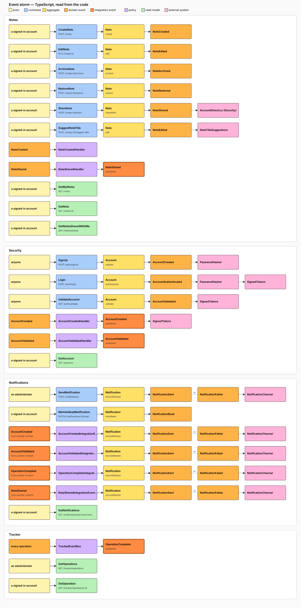
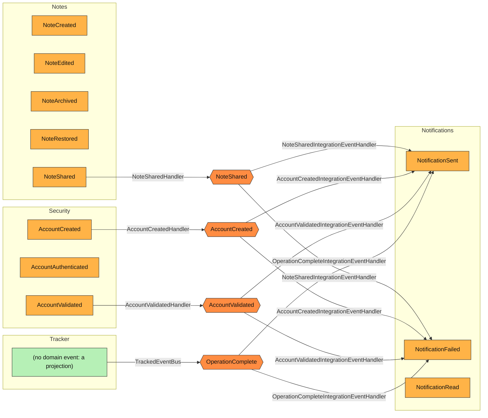
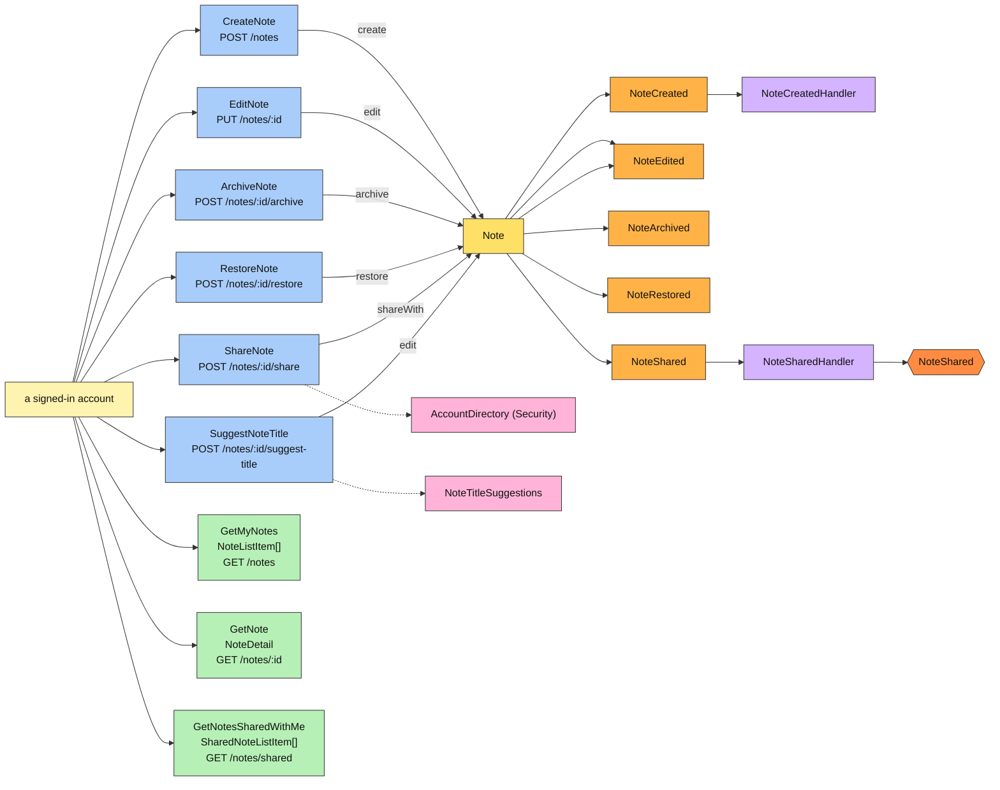
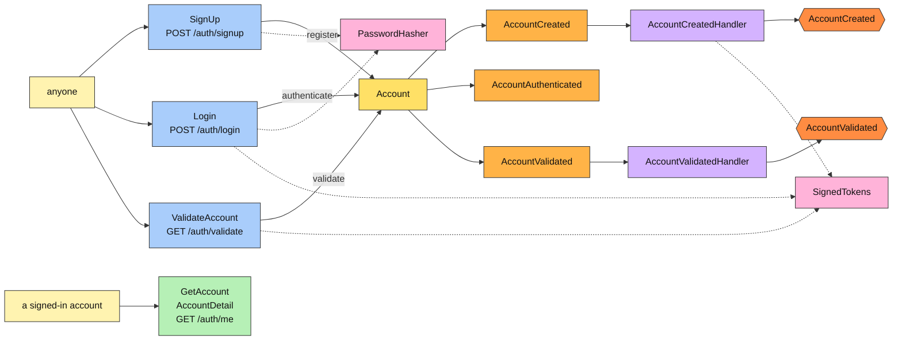
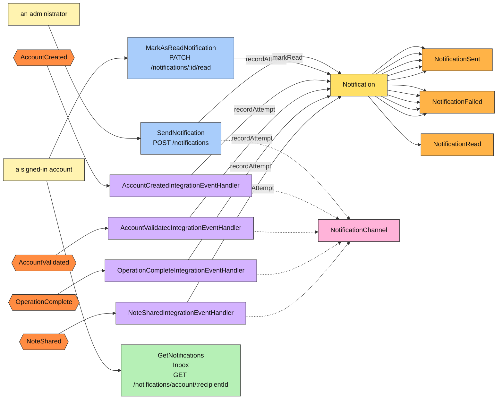
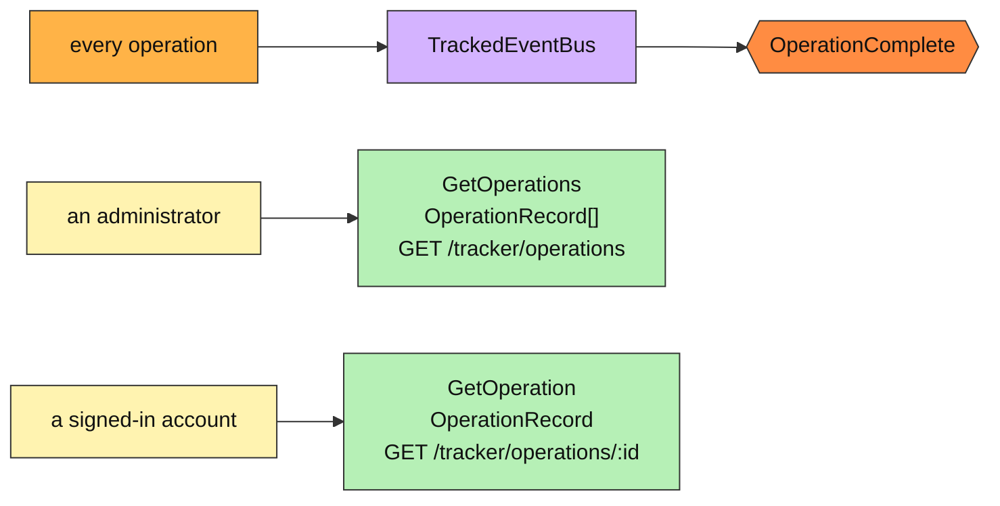

# The event storm, read from the code

What an event-storming session would put on the wall for this application — actors, commands, aggregates, domain events, policies, read models, external systems, and the integration events that pivot from one context to the next — read from the TypeScript tree rather than drawn by hand, so that it is true to the code the day it is rendered and every day after ([ADR 20](adr/0020-the-event-storm-is-read-from-the-code.md)). `yarn --cwd typescript conventions:write` regenerates this page and the board; `yarn check:conventions` fails when either differs from what the code renders.

The board, as one picture: [`event-storm.svg`](event-storm.svg).

Where each sticky comes from:

| Sticky | Read from |
|---|---|
| actor | the guard of the handler: `requireSignedIn()` is a signed-in account, a `guard()` that admits the administrator role alone is an administrator, nothing is anyone |
| command | the `commands` of the context's wiring file, by public name; its route from the controller method the route binds |
| aggregate · behaviour | the aggregate's method the handler asks, directly or through a service |
| domain event | what that behaviour `record()`s |
| policy | the handlers the wiring subscribes to domain events and integration events, and a publisher that reacts to every operation |
| read model | the `queries` of the wiring, with the type each answers and its route |
| external system | a port under `Ports/` that is neither a repository nor a queries port; named for the context that answers it when the context map says so |
| integration event | published by a policy, consumed by another context's policy: the pivots, the same the context map's links carry |

From a terminal: `yarn --cwd typescript architecture storm` (`storm Notes` for one lane; `--markdown`, `--svg`, `--json`).

<!-- generated from the code (event storm); run yarn conventions:write -->
Read from the TypeScript tree. Colours are the ones a wall would have: actors in pale yellow, commands in blue, aggregates in yellow, domain events in orange, integration events in dark orange, policies in purple, read models in green, external systems in pink.

### The big picture

Each lane is a bounded context and holds its domain events, in the order the commands produce them; a hexagon is an integration event, the pivot from one context to the next, with the policy that publishes it on the way in and the one that consumes it on the way out.

### Notes

| Actor | Command | Route | Aggregate · behaviour | Events | Needs |
| --- | --- | --- | --- | --- | --- |
| a signed-in account | `CreateNote` | `POST /notes` | `Note.create` | `NoteCreated` | — |
| a signed-in account | `EditNote` | `PUT /notes/:id` | `Note.edit` | `NoteEdited` | — |
| a signed-in account | `ArchiveNote` | `POST /notes/:id/archive` | `Note.archive` | `NoteArchived` | — |
| a signed-in account | `RestoreNote` | `POST /notes/:id/restore` | `Note.restore` | `NoteRestored` | — |
| a signed-in account | `ShareNote` | `POST /notes/:id/share` | `Note.shareWith` | `NoteShared` | `AccountDirectory (Security)`, `NoteSharing.share` |
| a signed-in account | `SuggestNoteTitle` | `POST /notes/:id/suggest-title` | `Note.edit` | `NoteEdited` | `NoteTitleSuggestions` |

| On | Policy | Does |
| --- | --- | --- |
| `NoteCreated` | `NoteCreatedHandler` | logs |
| `NoteShared` | `NoteSharedHandler` | publishes `NoteShared` |

| Actor | Query | Route | Read model |
| --- | --- | --- | --- |
| a signed-in account | `GetMyNotes` | `GET /notes` | `NoteListItem[]` |
| a signed-in account | `GetNote` | `GET /notes/:id` | `NoteDetail` |
| a signed-in account | `GetNotesSharedWithMe` | `GET /notes/shared` | `SharedNoteListItem[]` |

| External system | Port | Answered by | Adapters |
| --- | --- | --- | --- |
| NoteTitleSuggestions | `INoteTitleSuggestions` | an adapter of this context | `FirstLineTitleSuggestions` |
| AccountDirectory | `IAccountDirectory` | Security | `SecurityAccountDirectory` |

Recorded and handled by nobody yet (the Tracker still records them): `NoteEdited`, `NoteArchived`, `NoteRestored`.

### Security

| Actor | Command | Route | Aggregate · behaviour | Events | Needs |
| --- | --- | --- | --- | --- | --- |
| anyone | `SignUp` | `POST /auth/signup` | `Account.register` | `AccountCreated` | `PasswordHasher`, `AccountRegistration.register` |
| anyone | `Login` | `POST /auth/login` | `Account.authenticate` | `AccountAuthenticated` | `PasswordHasher`, `SignedTokens` |
| anyone | `ValidateAccount` | `GET /auth/validate` | `Account.validate` | `AccountValidated` | `SignedTokens` |

| On | Policy | Does |
| --- | --- | --- |
| `AccountCreated` | `AccountCreatedHandler` | publishes `AccountCreated`, needs `SignedTokens` |
| `AccountValidated` | `AccountValidatedHandler` | publishes `AccountValidated` |

| Actor | Query | Route | Read model |
| --- | --- | --- | --- |
| a signed-in account | `GetAccount` | `GET /auth/me` | `AccountDetail` |

| External system | Port | Answered by | Adapters |
| --- | --- | --- | --- |
| PasswordHasher | `IPasswordHasher` | an adapter of this context | `BcryptPasswordHasher` |
| SignedTokens | `ISignedTokens` | an adapter of this context | `JoseSignedTokens` |

Recorded and handled by nobody yet (the Tracker still records them): `AccountAuthenticated`.

### Notifications

| Actor | Command | Route | Aggregate · behaviour | Events | Needs |
| --- | --- | --- | --- | --- | --- |
| an administrator | `SendNotification` | `POST /notifications` | `Notification.recordAttempt` | `NotificationSent`, `NotificationFailed` | `NotificationChannel`, `NotificationDelivery.deliver` |
| a signed-in account | `MarkAsReadNotification` | `PATCH /notifications/:id/read` | `Notification.markRead` | `NotificationRead` | — |

| On | Policy | Does |
| --- | --- | --- |
| `AccountCreated` (integration event) | `AccountCreatedIntegrationEventHandler` | asks `Notification.recordAttempt`, → `NotificationSent`, → `NotificationFailed`, needs `NotificationChannel` |
| `AccountValidated` (integration event) | `AccountValidatedIntegrationEventHandler` | asks `Notification.recordAttempt`, → `NotificationSent`, → `NotificationFailed`, needs `NotificationChannel` |
| `OperationComplete` (integration event) | `OperationCompleteIntegrationEventHandler` | asks `Notification.recordAttempt`, → `NotificationSent`, → `NotificationFailed`, needs `NotificationChannel` |
| `NoteShared` (integration event) | `NoteSharedIntegrationEventHandler` | asks `Notification.recordAttempt`, → `NotificationSent`, → `NotificationFailed`, needs `NotificationChannel` |

| Actor | Query | Route | Read model |
| --- | --- | --- | --- |
| a signed-in account | `GetNotifications` | `GET /notifications/account/:recipientId` | `Inbox` |

| External system | Port | Answered by | Adapters |
| --- | --- | --- | --- |
| NotificationChannel | `INotificationChannel` | an adapter of this context | `EmailChannel`, `WebSocketChannel` |
| nboxFilters | `InboxFilters` | an adapter of this context | — |

Recorded and handled by nobody yet (the Tracker still records them): `NotificationSent`, `NotificationFailed`, `NotificationRead`.

### Tracker

| On | Policy | Does |
| --- | --- | --- |
| every operation | `TrackedEventBus` | publishes `OperationComplete` |

| Actor | Query | Route | Read model |
| --- | --- | --- | --- |
| an administrator | `GetOperations` | `GET /tracker/operations` | `OperationRecord[]` |
| a signed-in account | `GetOperation` | `GET /tracker/operations/:id` | `OperationRecord` |
<!-- end generated -->
