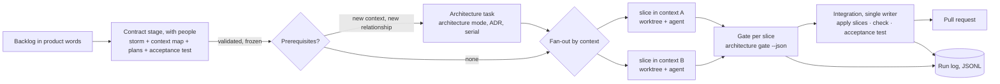

# RFC 0001 — An architecture-aware multi-agent development flow

**Status:** proposed. One open question is decided and implemented (§16, question 1). **Phase 1 is done**: `clean-ddd gate`, the driver in `.claude/flow/`, and three runs on a created project whose gate verdicts matched a person's reading — [the record](../evaluations/2026-10-29-flow-phase-1.md), with the guesses a created project still left an agent to make. The two that came back three times out of three — no composition root, and no way to follow a command's 202 — are closed by [ADR 27](../adr/0027-a-created-application-starts-with-the-tracker.md): a created project starts with the Tracker and the composition root that serves it, and the checklists answer the rest. **Phase 2 is done**: one cross-context feature delivered twice by two agents in parallel worktrees against a frozen contract, integrated by one writer, with no human edit after the contract stage — [the record](../evaluations/2026-10-29-flow-phase-2.md). Getting there took two architecture changes the contract stage needs: a relationship declared before its code ([ADR 28](../adr/0028-a-relationship-is-decided-before-its-code.md)) and a contract that may be in progress until its feature is integrated ([ADR 29](../adr/0029-a-contract-may-be-in-progress.md)).
**Scope:** whether a project built on clean-ddd should be developed by several coding agents at once, what that needs from clean-ddd, and what belongs elsewhere.
**Reference case:** a real project — one application, **one language**, created with `clean-ddd create --language <id>`, growing feature by feature from a backlog. Not this repository, whose four languages are a property of the reference and of no real project.
**Recommendation:** **modify.** Give created projects the contracts that make parallel work safe (a context map and storms from day one), add a machine-readable completion gate and a run log to the existing tooling, and parallelise along the boundary the architecture already enforces: the bounded context. Do not build a `flow/` package in this repository. Decide on a standalone orchestrator only after a benchmark on a real backlog shows that several agents beat one.

## 1. Executive summary

The request asks for an orchestrator that plans, schedules, isolates, validates and integrates the work of several coding agents, using clean-ddd's architecture as the coordination mechanism. The question is answered for the case that matters: a team's project in one language, not the four-language reference.

1. **Is an external orchestrator needed?** Not yet. The constrained implementer exists (`feature-author`, under the feature mode), the contracts exist (feature plans, storms, the context map, the import rules), and so do the checks. A created project, however, starts **without** the two contracts that would let agents work without talking — the context map and the storms — and nothing turns "the checks pass" into a verdict a script can read. Those gaps are small and belong in clean-ddd. The driver that starts agents can stay a script until a measurement says otherwise.
2. **What is the right granularity?** The unit of **work** is a feature's slice in one bounded context: every layer of that context, from domain to presentation and tests. A feature inside one context is one slice; a feature that crosses contexts is one slice per context, joined by an integration event fixed before either slice is written. The unit of **integration** is the whole feature. Splitting by layer is excluded; splitting inside one context has no seam the architecture enforces.
3. **What does coordination cost?** Unknown. The parallel runs made in this repository so far fanned out by *language*, an axis a real project does not have, so they say nothing about the real case. The benchmark (§10) runs on a project created from scratch with a realistic backlog, and must be able to conclude that one agent is better.

## 2. What a real project has, and what it lacks

What `clean-ddd create --language typescript` produces today (checked on a fresh project): the building blocks (`src/Architecture`), the shared kernel's domain and guards, an empty `src/Contexts`, the binding with `contexts: []`, the contract and concepts, `conventions/plans/`, one ADR, the `.claude/` agent and skills, the linter, and the `clean-ddd` package for the CLI and the check.

| Capability the flow needs | In a created project | Reuse |
| --- | --- | --- |
| A permitted modification scope | The two modes ([ADR 9](../adr/0009-work-is-done-in-one-of-two-modes.md)): `architecture mode feature --base <ref>` refuses changes to the building blocks, the shared kernel's model, `conventions/` (plans and storms aside), `docs/adr` | Directly: it is the scope check |
| A constrained cross-layer implementer | `.claude/agents/feature-author.md` and the `feature` skill: one feature, every layer, stop and report when the architecture must change | Directly: it is the agent's brief |
| Planning in architectural words | `plan validate\|explain`; the `storm` skill and `storm validate\|--expect` ([ADR 22](../adr/0022-the-storm-is-facilitated-and-the-code-is-held-to-it.md)) | Directly, once storms exist in the project (gap G1) |
| Boundaries that keep parallel work apart | The import rules: a context imports no other context (ARCH-INWARD, CTX-CONTRACTS), so two contexts are two disjoint directories, by construction | Directly: it is what makes per-context parallelism safe |
| Cross-context contracts held to the code | The context map and CTX-MAP-DECLARED — **only when `conventions/domain.yaml` exists** | Not available by default (gap G1) |
| Guidance and canonical examples | `checklist`, `concept`, `rule`, `verb`, `can-import`, `plan explain`; the created binding keeps the 19 of 49 concepts whose files it has — the building blocks | The guidance directly; the feature-level examples are missing (gap G7) |
| Checks | The language's linter and the conventions check; the project's own tests | Directly, behind one gate (gap G2) |
| An empirical protocol | `docs/evaluations/` in the reference: fresh agents, product-words requests, rubrics written first | Extended into the benchmark |

### Gaps that stop safe parallel work in a real project

- **G1 — the coordination contracts are optional and absent.** A created project has no `domain.yaml` and no storms directory. Without the context map, CTX-MAP-DECLARED does not run, so two agents can invent two different integration events for the same fact, or couple two contexts nobody decided to couple, and the check says nothing.
- **G2 — no machine-readable completion verdict.** The agent is told which commands to run and to paste their output. A driver cannot decide "accept, retry or block" from prose, and agents' reports can be wrong: in this repository two agents reported a defect that existed only in a file another worker was still editing.
- **G3 — shared hot spots outside the contexts.** A new context changes the binding (`contexts:` in `conventions/`, architecture mode), the composition root (which a created project does not have yet: the first feature creates it, and every new context then adds its module and routes there), and possibly the shared kernel. These are not slices of a feature; they are prerequisites, and they serialise.
- **G4 — shared runtime resources.** End-to-end tests and servers listen on a default port. In this repository an agent once ran its tests against another agent's server on that port and passed.
- **G5 — no telemetry.** Nothing records tokens, cost or time per feature.
- **G6 — interruption is unplanned.** Usage limits stopped six agents mid-work during the development of this repository; recovery relied on a person re-running every check.
- **G7 — nothing to copy in an empty project.** The guides tell an agent to follow an existing feature rather than invent a shape, and the checklists name the canonical file to copy. In a created project those files — an aggregate in a context, a command handler, a route, a wiring file — do not exist until someone writes the first feature. The `clean-ddd` package already bundles the reference's tree for `create`; the context package can draw the examples from there.

## 3. What the proposal solves, and what it does not

It solves: delivering a project's backlog sooner than one agent working through it in order, at a known cost, with the same quality gates; and making that claim testable.

### Non-goals

- A generic multi-agent framework.
- Splitting work by architectural layer.
- Weakening any rule to make generated code pass: a failed gate is a failed task.
- Deciding the domain model for the team. Storms are facilitated with people (the `storm` skill says the facilitator never decides a hot spot alone); the flow consumes their output.
- Machine-learned scheduling.
- Automatic merging into the main branch.
- The four-language reference as a use case: it is kept as the place where clean-ddd's own tooling is developed, not as the benchmark.

## 4. Architecture



Three responsibilities, kept apart:

- **clean-ddd** keeps the rules and answers questions about them. It gains a `gate` command, a `pack` command and better defaults in `create`. It learns nothing about runs, agents or budgets.
- **The driver** schedules, starts agents, collects verdicts, integrates, logs. In the first phases it is a script, or a Claude Code workflow shipped in `.claude/`. If it grows into an orchestrator, it is its own repository, used on any project (§11).
- **The benchmark** reads run logs and grades results. It does not run inside the driver.

## 5. Interfaces and data contracts

### What clean-ddd adds

**`clean-ddd gate --base <ref> --json`** runs the mode check against the base, the conventions check, format, lint, types and tests, in that order, stops at the first architectural failure, and answers one verdict:

```json
{
  "base": "4c1e2a0",
  "verdict": "fail",
  "steps": [
    { "name": "mode feature", "status": "pass" },
    { "name": "conventions", "status": "fail", "rule": "CTX-MAP-DECLARED",
      "lines": ["Billing → Notes: the code carries a link the context map does not declare"] },
    { "name": "tests", "status": "skipped" }
  ],
  "durationMs": 48211
}
```

It is the completion contract (G2), the same command a person runs, and it works in any created project because it only runs what the project already has.

**`clean-ddd pack --plan <file> --json`** prints what one slice needs: the plan, the storm's delta for that context, the rules its kinds touch, the checklists, the canonical examples — from the project when it has them, from the reference bundled in the package when it does not (G7) — the integration contracts the slice publishes or consumes, the gate. Whether an agent given the pack does better than an agent told to read the guide is a benchmark question, not an assumption.

**`clean-ddd create`** scaffolds an empty context map (`conventions/domain.yaml` with no subdomain, no context, no relationship) and a `conventions/storms/` directory, so that CTX-MAP-DECLARED and the storm check run from the first feature on (G1).

### What the driver owns — an execution plan

The feature plan says *what*; the execution plan says *how this run executes it*, and refers to plans and storms by path.

```yaml
run: billing-quota-2026-11-02
features:
  - storm: conventions/storms/note-quota.yaml        # crosses Billing → Notes
    slices:
      - { context: Billing, plan: conventions/plans/note-quota.billing.yaml }
      - { context: Notes,   plan: conventions/plans/note-quota.notes.yaml }
    acceptance: test/e2e/note-quota.e2e.spec.ts     # written in the contract stage, red until integration
  - storm: conventions/storms/pin-a-note.yaml        # inside Notes
    slices:
      - { context: Notes, plan: conventions/plans/pin-a-note.yaml }
agent: { runner: claude-code, model: <id> }
budget: { tokens: 1500000, wallClockMinutes: 90 }
parallelism: 2
retry: { perSlice: 1 }
ports: { base: 10100 }                               # one port per slice, allocated from here
```

Validation: each storm passes `storm validate`; each plan passes `plan validate`; every relationship a storm uses is declared in the context map, or the run has an architecture task that declares it first; every context a plan names is declared in the binding, or there is an architecture task that adds it.

### Interfaces that earn their keep

| Interface | Why it is a seam | Implementations in sight |
| --- | --- | --- |
| `AgentRunner.run(task, workspace, budget) → { exitReason, usage?, transcriptPath }` | The provider changes; the flow does not | Claude Code headless first; a second provider proves the seam |
| `ArchitectureAdapter` — `gate(base)`, `pack(slice)`, `conflictKeys(plan)` | It lets the same driver run on a project without clean-ddd, which the benchmark needs for a fair comparison | clean-ddd; a plain project (its test command, no pack, top-level directories as keys) |
| `Workspace` — create from a base, run in, export a patch, remove | Worktrees now, containers when §8 requires them | git worktree; later a container |
| `RunLog.append(event)` / `RunLog.fold(run)` | Persistence of the state machine | JSONL file per run |

The planner, dependency analysis, scheduler, strategy selection, validation, integration and telemetry are functions in the driver until one of them has a second implementation.

## 6. Execution lifecycle

| State | Meaning | Leaves to |
| --- | --- | --- |
| `PENDING` | Declared, prerequisites not met | `READY`, `CANCELLED` |
| `READY` | Prerequisites integrated, conflict keys free | `RUNNING`, `CANCELLED` |
| `RUNNING` | An agent works in the slice's workspace, under a lease | `VALIDATING`, `FAILED`, `CANCELLED`, `READY` (lease expired: interrupted) |
| `VALIDATING` | The driver runs the gate | `INTEGRATING` (every slice of the feature passed), `READY` (retry), `FAILED`, `BLOCKED` |
| `INTEGRATING` | The single writer applies the feature's slices and re-checks | `COMPLETED`, `FAILED`, `BLOCKED` |
| `COMPLETED` | Integrated, verified, pull request opened | — |
| `FAILED` | Retries spent, or a non-retryable failure | — |
| `BLOCKED` | Needs a person: the agent asked for an architecture change or a contract change, or the failure is not the slice's | `READY` once unblocked, `CANCELLED` |
| `CANCELLED` | Stopped on request | — |

Invariants: `RUNNING` only under a fresh lease; at most one feature `INTEGRATING`; `INTEGRATING` only through a verdict produced by the driver, never by an agent's report; `COMPLETED` only after the integrated branch passes the gate and the feature's acceptance test.

Persistence is one append-only JSONL file per run; a slice's state is a fold over it, so resuming is "fold, continue what is not terminal", and replaying a file twice changes nothing. An interrupted slice leaves a worktree: resume continues in it when its gate passes, or discards it and re-runs the slice once. SQLite becomes useful when the benchmark queries hundreds of runs, as an index built from the files.

## 7. Scheduling

### Three kinds of dependency

- **A prerequisite** — a feature needs a context that does not exist, a relationship the map does not declare, or a change to the shared kernel's model. That is an architecture task, in architecture mode, with its decision recorded; it runs first and alone. Early in a project's life most features need one, so early on the flow is mostly serial. This is a property of greenfield work, not a defect of the scheduler, and the benchmark should show it.
- **A contract between slices** — a cross-context feature's producer and consumer. Under contract-first this is **not** a task dependency: the storm fixes the integration event's name and payload before either slice is written, and both are implemented against it at once.
- **A conflict between features** — two features changing the same aggregate, or the same context's wiring and routes. Not a dependency either: a resource, handled below.

### The contract stage

Before any fan-out, the contract is produced and validated — with the people who decide the domain, through the `storm` skill: the storm (`storm validate` passes, its hot spots decided), the relationships in the context map, one plan per slice, and **one acceptance test of the user-visible flow**, written in the project's own end-to-end style and red against the current code. The contract is then frozen for the run. A slice that finds it wrong stops and is `BLOCKED` with what it found; nobody patches a contract mid-run.

### Resources

The conflict key of a slice is its **bounded context**. Two slices in different contexts touch disjoint directories by construction, because the import rules forbid a context to reach into another. Two slices in the same context are serialised. That is coarse — two features on different aggregates of the same context could often run together — and it is chosen because it is simple, deterministic and derivable from the plans; whether finer keys `(context, aggregate)` with integration-time conflict detection pay for themselves is a benchmark question.

The shared hot spots outside the contexts are handled by rule, not by lock: the binding and the context map change only in architecture tasks (serial, §7 above); the integration contracts in the shared kernel are written in the contract stage and frozen; the composition root's change for a new context is part of that context's architecture task. A slice in feature mode never touches any of them, and the gate refuses it if it does.

Runtime resources (G4): each slice gets its own port, from the execution plan.

### The algorithm

A DAG of slices and architecture tasks; Kahn's order with cycle detection; ties broken by the longest remaining path, then by id, so the order is reproducible. A slice enters `RUNNING` only if its context is free, its feature's prerequisites are integrated, and the remaining budget covers its estimate (a fixed estimate at first, later the median of logged runs). Default parallelism: **one**. A run asks for more explicitly, and the log records why.

## 8. Isolation

A git worktree per slice, on a branch `run/<run>/<slice>`, from the run's base commit, exported as a patch at `INTEGRATING`, removed at a terminal state. Processes are controlled by their own process group, never by name: in this repository a `pkill` by pattern once killed the coordinator's shell.

Worktrees do not isolate processes, ports, caches, credentials or the network. Ports are allocated; build caches are shared on purpose and protected by the toolchains' own locks. **Containers become necessary** when agents run requests nobody reviewed on a machine holding credentials, or when slices need the same fixed resource (one database). The first phases run in a disposable checkout or an already-isolated cloud session, where neither holds.

## 9. Integration

One writer, one temporary branch per feature, from the current base:

1. Every slice of the feature has a passing verdict produced by the driver.
2. Apply the slices' patches. A patch that does not apply is a **git conflict** — rare between contexts, and a sign the conflict keys were too fine.
3. Regenerate what the project generates (`clean-ddd check --write`).
4. Run the gate on the combination: a broken rule is an **architectural conflict**; CTX-MAP-DECLARED refusing a link, or the storm's `--expect` listing what is still owed, is a **contract incompatibility** between the slices.
5. Run the full test suite: a failure no slice's own gate saw is a **regression** of the combination.
6. Run the feature's acceptance test: a failure is a **behavioural conflict** — the slices honour the contract each on its own, and the feature still does not work.
7. Green: commit, push, open the pull request. A person merges.

A failed integration sends the slice the failure points at back to `READY` once, with the failing lines in its brief; a second failure marks the feature `BLOCKED`. Retry budgets never reset inside a run, so there is no loop.

## 10. Telemetry and benchmark

### What is recorded

Per slice: wall-clock and agent time, queue time, gate time and verdict, retries, changed files, failed rule ids, human interventions. Per agent run: tokens and cost **only when the runner reports them** (Claude Code's headless JSON output is the first thing Phase 1 verifies); an unreported metric is recorded as absent, never estimated. Per run: lead time from frozen contract to opened pull request, total cost including the contract stage and the driver's own agent, if it uses one.

### Objectives

Quality is a constraint: a run whose result fails the gate, the acceptance test or the rubric is a failure, whatever it cost. Among passing runs, two objectives side by side — **lead time for the backlog** and **cost per integrated feature** — and reliability as the rate of passing runs. A Pareto table, no weighted score.

### The benchmark: a real backlog, from an empty project

Each run starts from `clean-ddd create --language typescript` (one language per experiment; a second language is a second experiment, not a second arm), and delivers the same backlog, written in product words — for instance a notes product grown the way this reference grew:

1. Notes: create, edit, archive and restore a note (the first context, the composition root — architecture tasks first).
2. Pin a note (one context).
3. Tags on a note (one context, a value object).
4. Share a note with an account (needs a Security context: a new context and a relationship).
5. Notify recipients when a shared note is archived (cross-context, two slices).
6. A plan and a ten-note quota (a new context; the storm decides whether it is one).
7. Remind a note at a time (cross-context, scheduling; its storm already exists in this reference).

| Arm | What runs |
| --- | --- |
| A — one agent | One fresh agent takes the backlog in order, with the guides, the storms and the gate |
| B — naive parallel | One agent per feature, as many at once as the parallelism allows, no contract stage, no conflict keys; same integrator |
| C — architecture-aware | Contract stage, prerequisites first, slices fanned out by context, the gate, the single-writer integration |
| C′ — with the pack | C, with `clean-ddd pack` instead of "read the guide" |

Same model, same budget ceiling, same storms where an arm uses them, same rubric written before any run, same integrator; at least three runs per arm; results as ranges. The backlog is deliberately mixed: features 2, 3 and 5 can run beside one another, features 1, 4 and 6 need architecture tasks first. A flow that only wins on independent features is a finding.

Known biases, written down before the first run: the backlog mirrors this reference's own history, which a model may have seen (the runs use a project created from scratch, never a clone of this repository); the grader also wrote the guides (a second grader for a sample); arm C's contract stage involves a person, whose time is counted.

The benchmark must be able to say **A is better**. Then the recommendation is one agent, with the gate, the context map and the storms — which are worth having with one agent too.

## 11. Alternatives considered

| Alternative | Why not, or not yet |
| --- | --- |
| **A `flow/` package in this repository** | [ADR 23](../adr/0023-the-tooling-lives-at-the-root-and-ships-as-a-package.md) refuses a second package at the root, and an orchestrator for real projects has no reason to live inside the reference. If built, it is its own repository and talks to projects through `clean-ddd gate` and `pack`. |
| **No new tooling** — skills and the existing agent | Close to enough for one agent. What several agents need on top is a verdict a script can read, the context map present from day one, and a log. |
| **Agents by layer** | Excluded by the request; the architecture makes it worse, because a layer's change means nothing without the layers it serves. |
| **One agent per feature, whatever it crosses** (arm B) | The simplest parallel strategy, and the baseline. It loses when two features meet in the same context or invent two contracts for one fact — which the benchmark measures rather than assumes. |
| **Fine-grained locks with optimistic merging** | More throughput when conflicts are rare, more wasted work when not. The coarse per-context lock is measured first. |
| **Fanning out by language**, as done while building this reference | Not available in a real project. It is where the evidence gathered so far comes from, which is why that evidence is not used here. |
| **An ML-based strategy selector** | No data; deterministic rules logged with their inputs are auditable. |

## 12. Risks

| Risk | Mitigation | How it is tested |
| --- | --- | --- |
| Orchestration costs more than it saves | Arm A in every benchmark; contract stage and driver counted | Published ranges, negative results included |
| Early backlog is all prerequisites, so nothing parallelises | Accept it; parallelism defaults to one | The backlog's first features; lead time per phase of the backlog |
| A frozen contract is wrong | Slices stop and report; the contract is re-decided with people | A run seeded with an ambiguous storm |
| Two features invent two contracts for one fact | Context map from day one; contracts written in the contract stage | Arm B against arm C on features 4 and 5 |
| Hidden conflict within one context | Per-context lock; integration re-checks everything | Two features on the same context, with and without the lock |
| Agent reports are trusted | The gate is run by the driver | A runner stub that reports success on failing code |
| Interruptions lose work | Leases, JSONL events, resumable worktrees | Kill the driver and an agent mid-run; resume |
| Shared ports and processes collide | Allocated ports; process groups | Two slices whose tests use the same port must fail the gate |
| Telemetry is invented | Absent stays absent | A runner that reports nothing must produce gaps, not zeros |
| Provider lock-in | `AgentRunner` with a second implementation by Phase 3 | The same run on two runners |
| Autonomous commands with credentials | Disposable checkout; containers before unreviewed requests | A slice that reads outside its worktree |
| The benchmark flatters the architecture | Arms A and B; fresh projects; a second grader; preregistered hypotheses | Published with the results |
| Over-engineering | Interfaces only where two implementations exist | Review each new type against that rule |

## 13. Proposed changes

In this repository, all in the existing tooling and agent files:

```
tools/src/gate.ts                    `clean-ddd gate --base <ref> --json` (Phase 1)
tools/src/create.ts                  scaffold an empty conventions/domain.yaml and conventions/storms/ (Phase 1)
tools/src/pack.ts                    `clean-ddd pack --plan <file> --json` (Phase 3)
.claude/agents/feature-author.md     "end with `clean-ddd gate`" instead of a list of commands; copied into created projects
.claude/flow/                        the driver, while it is one script (Phase 1: run-feature.mjs)
docs/rfc/                            this RFC; an ADR replaces it once decided
```

Nothing under `conventions/` changes in this repository: an execution plan is the driver's, and the contract does not learn what a run is.

## 14. Roadmap

| Phase | Delivers | Exit criterion |
| --- | --- | --- |
| 0 — RFC | This document, a decision, an ADR | The maintainer adopts, modifies or rejects it |
| 1 — Contracts and gate in created projects | `create` scaffolds the context map and storms; `clean-ddd gate`; one feature in a created project through one isolated agent, its verdict and usage logged | On three runs the gate's verdict matches a person's reading of the same checks; the source of every usage number is confirmed or recorded as absent |
| 2 — One cross-context feature, two slices | The contract stage with its acceptance test; two slices in parallel worktrees; single-writer integration; allocated ports | Feature 5 of the backlog delivered twice into a green pull request with no human edit after the contract stage |
| 3 — Interruption and a second runner | Leases, resume, cancel; a second `AgentRunner` | A run killed mid-way resumes to the same result; the same run passes on two runners |
| 4 — Benchmark | Arms A, B, C, C′ on the backlog, three runs each | Published ranges, whatever they say |
| 5 — Features in parallel | Per-context locks across features; prerequisites as architecture tasks | Only if Phase 4 shows C beats A |
| 6 — Strategy selection | Rules choosing one agent or the fan-out from a feature's characteristics (contexts crossed, prerequisites, plan size), logged with their inputs | Only with enough logged runs to evaluate the rules |

Observability moves into Phase 1: a run that is not measured cannot justify the next phase.

## 15. Estimated complexity

Relative sizes, not durations: nothing yet records how long a change takes, which Phase 1 starts doing.

| Piece | Size | Why |
| --- | --- | --- |
| `clean-ddd gate` | Small | The commands exist; it orders them and emits JSON |
| `create` scaffolding the map and storms | Small | Two files and a directory; the check already handles an empty map |
| The contract stage | Medium | The `storm` skill exists; the acceptance test written first is a new habit, with a person in the loop |
| The driver (Phases 1–2) | Medium | Worktrees, processes, ports, a JSONL log, one runner |
| Resume, cancel, a second runner | Medium | Leases and an adapter |
| `clean-ddd pack` | Small | `plan explain` in a machine format |
| The benchmark | Large | Seven features × four arms × three runs is eighty-four deliveries to grade |
| A standalone orchestrator repository | Large | Only if Phase 4 justifies it |

## 16. Open questions

1. ~~**Should every created project start with a context map**, even an empty one?~~ **Decided: yes** (the maintainer, 2026-10-29). `create` scaffolds an empty `conventions/domain.yaml` and `conventions/storms/`, so CTX-MAP-DECLARED and the storm check run before the first cross-context feature. It is worth doing whatever is decided about the rest of this RFC: it helps one agent as much as several. Implemented in the pull request that followed this RFC's: `create` writes both, the context checklist of every binding says a context is described in the map, and outside TypeScript the check holds the map to the links the language's own tool writes in its inventory.
2. **Who writes the acceptance test in the contract stage** — the person who decides the storm, or an agent whose test that person reviews?
3. **Is a human approval required between the contract stage and the fan-out?** The `storm` skill already says hot spots are decided by people.
4. **How coarse should the conflict key be** — the context, or `(context, aggregate)`? The RFC starts coarse and lets the benchmark decide.
5. **Which budget source is authoritative** — the provider's reported cost, or tokens priced by a table kept with the run?
6. **Does the time of the person in the contract stage count against the strategy that needs it?** The benchmark says yes; it must be recorded to be counted.

## 17. Recommendation

**Modify.** Keep the proposal's principles — vertical ownership, architecture as the coordination mechanism, measure before optimising, one agent by default — and change three things:

- **Make the contracts present from day one.** A created project gets a context map and a storms directory, so the rules that let agents work without talking are switched on before the first cross-context feature.
- **Parallelise along the boundary the architecture enforces: the bounded context.** Slices in different contexts cannot touch each other's files, and the integration event between them is fixed before either is written. Same-context work is serialised. Prerequisites — new contexts, new relationships — run first, alone, in architecture mode.
- **Make the benchmark the decision point, on a real backlog from an empty project.** Parallel features, strategy selection and any standalone orchestrator exist only if arm C beats arm A on lead time, at an accepted cost, with the same quality.

Each is preferred to a simpler alternative for a stated reason: the gate over an agent's report, because reports were wrong in practice; the context map by default over an optional file, because the rule it switches on is the one that keeps parallel slices consistent; the per-context lock over finer locks, because it fails before work is spent; and the benchmark over judgement, because nothing measured yet says several agents deliver a real backlog sooner than one.
