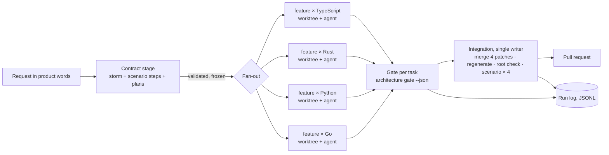

# RFC 0001 — An architecture-aware multi-agent development flow

**Status:** proposed, awaiting a decision. Nothing here is implemented.
**Scope:** whether clean-ddd should gain a flow orchestrator, and if so which part of it belongs in this repository.
**Recommendation:** **modify.** Adopt the contract-first fan-out, a machine-readable completion gate and a run log, inside the existing tooling. Do not build a `flow/` package in this repository now. Decide on a standalone orchestrator after a benchmark shows whether the thin version is worth more than one agent.

## 1. Executive summary

The proposal asks for an orchestrator that plans, schedules, isolates, validates and integrates the work of several coding agents, using clean-ddd's architecture as the coordination mechanism. The audit below finds that most of that mechanism already exists, and that one property of this repository changes the design more than any other: **every feature lands in four languages at once.** The check holds the four inventories equal (ARCH-ONE-APPLICATION) and one API scenario runs against the four servers (API-ONE-SURFACE), so a feature merged in one language alone turns `main` red.

That property decides the three questions the request puts first:

1. **Is an external orchestrator needed?** Not yet. The repository already has the contracts (storms, plans, the scenario, the inventories), the constrained implementer (the `feature-author` agent under the feature mode), the checks and an evaluation protocol. What is missing is small and belongs in the existing tooling: one command that says, in JSON, whether a task's result is acceptable; a stated contract-first stage; and a run log that records cost and time. A driver can stay a script or a Claude Code workflow until measurements show it must be more.
2. **What is the right granularity?** The unit of *work* is a feature in one language. The unit of *integration* is a feature in all four languages. Splitting a feature by layer is excluded by the request and by the architecture; splitting a feature inside one language has no seam to split on. Independent features in parallel are possible, but they contend on predictable files, and the gain over running them one after the other is unmeasured.
3. **What does coordination cost?** Unknown, and measurable. This session ran five multi-language changes with one coordinator and three agents each. The harness reported 110–230 thousand tokens and 4–13 minutes per agent; the coordinator's own consumption was not reported. Those numbers are anecdotes, not a comparison. Phase 4 measures it properly, and must be able to say that one agent was better.

## 2. What the repository already provides

| Capability the proposal asks for | What exists today | Reuse |
| --- | --- | --- |
| Feature planning, in architectural words | Feature plans (`conventions/plans/*.yaml`), `yarn architecture plan validate\|explain` against the contract and the tree; expected storms (`conventions/storms/*.yaml`), `storm validate` and `storm --expect` against the code ([ADR 22](../adr/0022-the-storm-is-facilitated-and-the-code-is-held-to-it.md)) | Directly: they are the FeaturePlan. |
| A language-neutral contract fixed before implementation | The storm (the model, in the inventory's words) and the shared API scenario (`api/scenario.mjs`, [ADR 16](../adr/0016-one-api-for-every-language.md)) | Directly, once the scenario has an owner at the contract stage (gap G1). |
| A permitted modification scope | The two modes ([ADR 9](../adr/0009-work-is-done-in-one-of-two-modes.md)): `yarn architecture mode feature --base <ref>` refuses a change to the building blocks, the shared kernel's model, `conventions/` (plans and storms aside), `docs/adr` and `tools/` | Directly: it is the scope check. |
| A constrained cross-layer implementer | `.claude/agents/feature-author.md`: one feature, one language, every layer, the feature mode, "stop and say so" when the architecture must change, a report of every guess | Directly: it is the AgentRunner's prompt. |
| Architectural guidance and canonical examples | `architecture checklist <kind>`, `concept <id>`, `rule <ID>`, `verb <intent>`, `can-import`, and `plan explain`, which expands a plan into files, rules and the canonical file to copy | Directly: the raw material of a context package. |
| Architecture checks per language | ESLint generated from the table for TypeScript; `cargo run -p conventions`, `uv run python -m tools.conventions`, `go run ./tools/conventions`; the root check (the map, the context map, the storms, the four inventories, ARCH-ONE-HANDLER) | Directly, behind one gate (gap G2). |
| Contract incompatibility detection | The inventories ([ADR 21](../adr/0021-one-application-every-language-writes-the-same-inventory.md)); since #80 a stale inventory names each difference in every language | Directly. |
| An empirical protocol | `docs/evaluations/`: fresh agents, a request in product words, a rubric written before the result, re-run verbatim after a fix; 17 records | Extended into the benchmark (Phase 4). |
| CI | One job per language and a `check` job that needs them all | Unchanged. |

### Gaps that prevent safe parallel development today

- **G1 — the scenario has no owner before implementation.** A feature that changes what a client sees adds steps to `api/scenario.mjs`, one file for four servers. Today the first implementer writes them. Four implementers in parallel would write four versions of the same steps.
- **G2 — no machine-readable completion contract.** The `feature-author` agent is told which commands to run and to paste their output. A driver cannot decide "accept, retry or block" from prose, and an agent's report can be wrong: in this session two agents reported a TypeScript defect that existed only in a file the coordinator was still editing.
- **G3 — integration is all-or-nothing per feature, and nothing says so.** ARCH-ONE-APPLICATION makes a feature present in one language and absent in another a red build. A scheduler that integrates per (feature, language) would break `main`. The rule is right; the flow has to know it.
- **G4 — shared runtime resources.** The servers listen on port 10000 by default. In this session an agent ran the scenario against another agent's server on that port and passed; it noticed only because it read its own server's log.
- **G5 — no telemetry.** The evaluation records note time spent and nothing about tokens or cost. The harness reports per-agent tokens and duration in its completion notice; nothing in the repository records them.
- **G6 — interruption is unplanned.** Usage limits stopped six agents mid-work in this session. Recovery worked because the work was on disk and the coordinator re-ran every check itself. Nothing records which task was where.

## 3. What the proposal solves, and what it does not

It solves: delivering one feature in four languages faster than one agent doing them in turn, with the same quality gates; making the cost of that delivery visible; and making the result reproducible enough to compare strategies.

### Non-goals

- A generic multi-agent framework. Nothing is built that clean-ddd does not need.
- Splitting work by architectural layer.
- Weakening any rule to make generated code pass. A failed gate is a failed task.
- Machine-learned scheduling. Heuristics first, data later.
- Automatic merging into `main`. A person approves the pull request, as today.
- Remote or containerised execution in the first phases (§8 says when it becomes necessary).

## 4. Architecture



Three responsibilities, kept apart as the request asks:

- **clean-ddd** keeps the rules and answers questions about them. It gains two read-only commands (§5) and no notion of a run, an agent or a budget.
- **The driver** schedules, starts agents, collects gate verdicts, integrates, logs. In Phases 1–3 it is a script (or a Claude Code workflow under `.claude/workflows/`). If it grows into an orchestrator, it lives in its own repository, not here (§11).
- **The benchmark** is the evaluation protocol with measurements and comparison arms. It reads run logs; it does not run inside the driver.

## 5. Core interfaces and data contracts

### What clean-ddd adds — two commands, read-only

**`yarn architecture gate --language <id> --base <ref> --json`** runs, in the language's directory, the mode check against the base, the language's conventions check, format, lint, types and tests, and answers one verdict:

```json
{
  "language": "rust",
  "base": "6504591",
  "verdict": "fail",
  "steps": [
    { "name": "mode feature", "status": "pass" },
    { "name": "conventions", "status": "fail", "rule": "ARCH-ONE-HANDLER",
      "lines": ["Notes: command PinNote is built by a route and no handler in the Module answers it"] },
    { "name": "tests", "status": "skipped" }
  ],
  "durationMs": 48211
}
```

It reuses the commands the `feature-author` agent already lists. It is the completion contract (G2), and the same command a person runs. Its steps stop at the first architectural failure, because running tests on code the architecture refuses wastes time.

**`yarn architecture pack --plan <file> --language <id> --json`** prints what a task needs to know: the plan, the storm delta, the rules the plan's kinds touch, the checklists, the canonical files to copy, the relevant guide sections, the commands of the gate. It is `plan explain` with a language and a machine format. Whether an agent given the pack does better than an agent told to read the guides is a benchmark question (§10), not an assumption.

### What the driver owns — an execution plan

The FeaturePlan says *what*; the execution plan says *how this run executes it*, and refers to plans and storms by path rather than restating them.

```yaml
run: remind-a-note-2026-11-02
storm: conventions/storms/remind-a-note.yaml
plans:                         # one per language, each validated by `plan validate`
  typescript: conventions/plans/remind-a-note.yaml
  rust: conventions/plans/remind-a-note.rust.yaml
strategy: contract-first-fan-out   # single-agent | contract-first-fan-out
agent: { runner: claude-code, model: <id>, maxTurns: 200 }
budget: { tokens: 1500000, wallClockMinutes: 90 }
parallelism: 4
retry: { perTask: 1 }
ports: { typescript: 10101, rust: 10102, python: 10103, go: 10104 }
integration: { target: pull-request }
```

The driver validates it in four steps: the storm passes `storm validate`; each plan passes `plan validate`; every language the contract lists has a plan or is explicitly excluded (and an excluded language means the run cannot integrate, because of G3); the ports are distinct.

### Interfaces that earn their keep

Of the eleven the request lists, four are seams with two real implementations in sight; the rest are functions.

| Interface | Why it is a seam | Implementations |
| --- | --- | --- |
| `AgentRunner.run(task, workspace, budget) → { exitReason, usage?, transcriptPath }` | The provider changes; the flow does not | Claude Code headless first; a second provider is what proves the seam |
| `ArchitectureAdapter` — `gate(language, base)`, `pack(task)`, `conflictKeys(plan)` | It is what lets the flow run on a repository that is not clean-ddd, and what makes the benchmark fair | clean-ddd (the two commands above); a plain repository (its test command, no pack, top-level directories as keys) |
| `Workspace` — create from a base, run in, export a patch, remove | Worktrees now, containers when §8 requires them | git worktree; later a container |
| `RunLog.append(event)` / `RunLog.fold(run)` | The state machine's persistence | JSONL file per run |

`FeaturePlanner`, `DependencyAnalyzer`, `Scheduler`, `StrategySelector`, `ValidationRunner`, `IntegrationManager` and `TelemetryCollector` are functions in the driver until a second implementation of one of them exists.

## 6. Execution lifecycle

### States

| State | Meaning | Leaves to |
| --- | --- | --- |
| `PENDING` | Declared, dependencies not met | `READY`, `CANCELLED` |
| `READY` | Dependencies integrated, resources free | `RUNNING`, `CANCELLED` |
| `RUNNING` | An agent works in the task's workspace, under a lease | `VALIDATING`, `FAILED`, `CANCELLED`, `READY` (lease expired: interrupted) |
| `VALIDATING` | The gate runs on the workspace | `INTEGRATING` (all tasks of the feature passed), `READY` (retry), `FAILED`, `BLOCKED` |
| `INTEGRATING` | The single writer merges the feature's patches and re-checks | `COMPLETED`, `FAILED`, `BLOCKED` |
| `COMPLETED` | Integrated into the run's branch, verified | — |
| `FAILED` | Retries spent, or a non-retryable failure | — |
| `BLOCKED` | Needs a person: the agent asked for an architecture change, or the failure is not the task's | `READY` once unblocked, `CANCELLED` |
| `CANCELLED` | Stopped on request | — |

Invariants: a task is `RUNNING` only while its lease is fresh; at most one task of the whole run is `INTEGRATING`; a task reaches `INTEGRATING` only through a gate verdict produced by the driver, never by the agent's report; `COMPLETED` is reached only after the integrated branch passes the root check and the scenario against every server.

### Persistence

One append-only JSONL file per run (`started`, `leased`, `agent-finished` with usage, `gate` with the verdict, `integrated`, `blocked`, …). The state of every task is a fold over that file, so resuming is "fold, then continue from what is not terminal". An interrupted agent leaves a worktree: resume either continues in it (when its gate passes) or discards it and re-runs the task once. Every event carries the run id and the task id, so replaying a file twice changes nothing.

SQLite is not needed for runs of four to twenty tasks with one writer. It becomes worth its dependency when the benchmark queries hundreds of runs, and then it is an index built from the JSONL files, not their replacement.

## 7. Scheduling

### Task dependencies are not context dependencies

A context dependency says Notes publishes and Notifications consumes. A task dependency says this work cannot start, or cannot be integrated, before that work is. Under contract-first, a cross-context feature has **no** task dependency between its producer and its consumer: the storm fixes the integration event's name and payload before either side is written, and both sides are implemented against it in parallel. Task dependencies remain where a feature needs an architecture change (the change is its own task, in architecture mode, and the feature waits for it) and between two features that touch the same aggregate.

### The contract stage

Before any fan-out, one task produces and validates the contract: the storm (`storm validate` passes; the room's hot spots decided), the scenario steps (they fail against all four servers, which proves they test something new), and one plan per language (`plan validate` passes). The contract is then frozen for the run. An implementer that finds the contract wrong does not change it: it stops, and the task is `BLOCKED` with what it found. That is G1 closed, and it is what lets four agents work without talking to each other.

### Resources

Within one feature, the four language tasks touch disjoint trees, their own inventory file and their own binding, which the feature mode forbids them to edit anyway. The shared files — the root README's generated blocks, the language READMEs, the four inventories compared together — are regenerated by the integrator, never edited by the agents. **No lock is needed inside a feature.**

Between features, the realistic conflict is two features changing the same aggregate, the same wiring file or the same routes file. The conflict key is derivable from the plans: `(context, aggregate)`. The recommended policy is **pessimistic and coarse**: two features with the same key never run at the same time. It is simpler than optimistic merging, it fails before work is spent rather than after, and in a repository whose features mostly live in Notes it will often serialise — which is a measurement worth having, not a defect to hide. Optimistic concurrency with integration-time detection is the alternative to test once the benchmark shows the lock costs lead time.

Runtime resources (G4) are reserved per task: a port per language server, from the execution plan.

### The algorithm

A DAG of tasks, a ready set, a parallelism limit, a budget. Kahn's order with cycle detection; ties broken by the longest remaining path, then by task id, so the order is reproducible. A task enters `RUNNING` only if its conflict keys are free and the run's remaining budget covers the task's estimate (initially a fixed per-language estimate, later the median of the logged runs). Parallelism defaults to the number of languages, because nothing measured yet says more helps.

## 8. Isolation

Git worktrees are the default: one per task, on a branch `run/<run>/<task>`, from the run's base commit, removed after the patch is exported. This session's agents worked in one shared checkout on disjoint directories and it held, but it leaked build artifacts and a `pkill` by pattern killed the coordinator's own shell — a worktree per task and process control by process id are the cheap fixes.

What worktrees do not isolate: processes, ports, caches, credentials, the network. Ports are reserved (§7). Caches are shared on purpose: per-task `target/` directories would make every Rust task build from scratch, so the Cargo target directory is shared and builds are serialised by Cargo's own lock. **Containers become necessary** when tasks may run commands nobody reviewed on a machine that holds credentials, or when two tasks need the same fixed resource. Neither is true of the first phases, which run on a developer's machine or in an already-isolated cloud session.

Lifecycle: a worktree is created at `RUNNING`, kept through `VALIDATING`, exported to a patch at `INTEGRATING`, removed at a terminal state. `flow cancel` stops the agent's process group, records the event and leaves the worktree for inspection until `flow clean`.

## 9. Integration

One writer, one temporary branch per feature, from the current base:

1. Every task of the feature has a passing gate verdict produced by the driver.
2. Apply the four patches. A patch that does not apply is a **git conflict**.
3. Regenerate what is generated: `yarn conventions:write` at the root, each language's inventory.
4. Run the root check: a broken rule is an **architectural conflict**; inventories that differ are a **contract incompatibility** (G3), named line by line since #80.
5. Run each language's suite: a failure that the task's own gate did not see is a **test regression** introduced by the combination.
6. Start the four servers on their reserved ports and run the scenario against each: a failure is a **behavioural conflict**.
7. All green: commit, push the branch, open the pull request. A person merges.

A failed integration does not retry the integration. It sends the failing language's task back to `READY` once, with the failing lines appended to its brief; a second failure marks the feature `BLOCKED`. The retry budget is per task and per feature and never resets inside a run, so there is no loop.

## 10. Telemetry and benchmark

### What is recorded

Per task: wall-clock and agent time, queue time, gate time and verdict, integration time, retries, changed files, the rule ids that failed, the scenario steps that failed, human interventions. Per agent run: input, output and cache tokens and cost **only when the runner reports them** — Claude Code's headless JSON output is the first thing Phase 1 verifies; a metric the provider does not give is recorded as absent, never estimated. Per run: lead time from accepted contract to opened pull request; total cost; the coordinator's own consumption, which this session could not see.

### Objectives

Quality is a constraint, not an objective: a run whose result fails any gate, the scenario or the rubric counts as a failure, whatever it cost. Among runs that pass, two objectives are reported side by side: **lead time** and **cost per integrated feature**. Reliability is the rate of runs that pass. No weighted score in the first phases: a Pareto table says more and hides less.

### The benchmark

The evaluation protocol, with arms and measurements:

| Arm | What runs |
| --- | --- |
| A — one agent | One fresh agent implements the feature in the four languages, in turn, with the guides |
| B — naive parallel | Four fresh agents, one per language, given the request and nothing else; integration by the same integrator |
| C — architecture-aware | Contract stage, then four `feature-author` agents with the frozen contract and the gate |
| C′ — with the pack | C, with `architecture pack` instead of "read the guides" |

Same model, same budget ceiling, same request in product words, same rubric written before any run, same integrator. At least three runs per arm per feature, because agents vary; results are reported as ranges, not as a winner. Features of increasing complexity: one context (pin a note), cross-context (notify on archive), and a feature that does not exist yet in any language — **remind a note**, whose storm is already decided — so that no arm can copy an existing implementation.

The benchmark must be able to say **A is better**: when it does, the recommendation is to keep one agent and keep the gate. Its known biases are written down before it runs: the features and the evaluation branches exist in the repository's history (the runs use a fresh clone without them); the maintainer who grades also wrote the guides (a second grader for a sample); the coordinator in arm C is itself an agent whose cost must be counted.

## 11. Alternatives considered

| Alternative | Why not, or not yet |
| --- | --- |
| **A `flow/` package in this repository**, as proposed | Decided against by [ADR 23](../adr/0023-the-tooling-lives-at-the-root-and-ships-as-a-package.md): the root's package is the tooling and nothing else, and a second package or a workspace at the root is refused. An orchestrator meant to run on any repository also has no reason to live inside one of them. If it is built, it is its own repository and talks to clean-ddd through `gate` and `pack`. |
| **No new tooling at all** — skills and the existing agent | Close to enough: this session delivered five multi-language changes that way. What it lacked was a verdict a script can read, a record of cost and time, and a stated contract stage. Those three are cheap. |
| **Agents organised by layer** | A non-goal of the request, and the architecture makes it worse: a layer's change is meaningless without the layers it serves, and the wiring file binds them. |
| **One agent per bounded context** across a feature | Contract-first already removes the need: the integration event is fixed before either side is written. Per-context agents would add a handoff inside each language. |
| **Optimistic concurrency between features** | More throughput when conflicts are rare; more wasted work when they are not. Measure the cost of the lock first. |
| **An ML-based strategy selector** | No data yet. Deterministic rules, logged with their inputs, are auditable; a model is not, until there is enough history to evaluate it. |

## 12. Risks

| Risk | Mitigation | How it is tested |
| --- | --- | --- |
| The orchestration costs more than it saves | Arm A in every benchmark; the coordinator's tokens counted | The benchmark's ranges; a negative result is published |
| A contract frozen too early is wrong | Implementers stop and report; the contract task is re-run, not patched in place | A seeded run with a deliberately ambiguous storm |
| Hidden dependency between "independent" features | Conflict keys from plans; integration re-checks everything | Two features on the same aggregate, scheduled with and without the key |
| Agent reports are trusted | The gate is run by the driver, never read from the report | A runner stub that reports success on failing code |
| Interruptions lose work or state | Leases, JSONL events, resumable worktrees | Kill the driver and an agent mid-run; resume; compare the result |
| Shared runtime resources collide | Reserved ports; no `pkill` by pattern | Two servers started on the same port must make the gate fail |
| Telemetry is invented | Absent stays absent; each metric has its source in the log | A runner that reports nothing must produce a report with gaps, not zeros |
| Provider lock-in | `AgentRunner` with a second implementation by Phase 3 | The same run with two runners |
| Autonomous commands on a machine with credentials | Worktrees on a disposable checkout; containers before running untrusted requests | A task that tries to read outside its worktree |
| The benchmark flatters the architecture | Arms B and A; features not in the history; a second grader | Preregistered hypotheses, published with the results |
| Over-engineering | Interfaces only where two implementations exist | A review of each new type against that rule |

## 13. Proposed repository changes

```
tools/src/gate.ts                    `architecture gate --language --base --json` (Phase 1)
tools/src/pack.ts                    `architecture pack --plan --language --json` (Phase 3)
.claude/agents/feature-author.md     "end with `architecture gate`" instead of the list of commands
.claude/workflows/fan-out.*          the driver, while it is small enough to be one script (Phase 2)
docs/rfc/                            this RFC; an ADR replaces it once decided
docs/evaluations/                    benchmark records next to the evaluation records (Phase 4)
```

Nothing is added under `conventions/`: an execution plan is the driver's, not the architecture's, and the contract does not learn what a run is.

## 14. Roadmap

| Phase | Delivers | Exit criterion |
| --- | --- | --- |
| 0 — RFC | This document, a decision, and an ADR recording it | The maintainer adopts, modifies or rejects it |
| 1 — The gate and one run | `architecture gate`; one feature in one language through one isolated agent, its verdict and usage in a JSONL file | The gate's verdict matches a person's reading of the same checks on three runs; the usage numbers' source is confirmed or recorded as absent |
| 2 — Contract-first fan-out | The contract stage; four language tasks in parallel worktrees; the single-writer integration; reserved ports | One feature, four languages, integrated into a green pull request with no human edit, twice |
| 3 — Interruption and a second runner | Leases, resume, cancel; a second `AgentRunner` | A run killed mid-way resumes to the same result; the same run passes on two runners |
| 4 — Benchmark | Arms A, B, C, C′ on three features, three runs each | Published ranges, whatever they say |
| 5 — Two features at once | Conflict keys, the lock, scheduling across features | Only if Phase 4 shows C beats A: two features on different aggregates integrate in less wall-clock time than one after the other |
| 6 — Strategy selection | Rules choosing A or C from a task's characteristics, logged with their inputs | Only with enough logged runs to evaluate the rules |

The request's phases are reordered: observability moves into Phase 1, because a run that is not measured cannot justify the next phase.

## 15. Estimated complexity

Relative sizes, not durations — this repository has no record of how long its own changes take, which is one of the things Phase 1 starts recording.

| Piece | Size | Why |
| --- | --- | --- |
| `architecture gate` | Small | The commands exist; it runs them, stops at the first architectural failure and emits JSON |
| The contract stage | Small to medium | The storm and the plans exist; the scenario-steps-first habit is new |
| The driver (Phases 1–2) | Medium | Worktrees, processes, ports, a JSONL log, one runner |
| Resume, cancel, a second runner | Medium | Leases and an adapter |
| `architecture pack` | Small | `plan explain` in a machine format, with the language |
| The benchmark | Large | Runs are cheap to start and expensive to grade; three features × four arms × three runs is thirty-six graded runs |
| A standalone orchestrator repository | Large | Only if Phase 4 justifies it |

## 16. Open questions

1. **Is all-or-nothing integration the right rule for the flow, or should a feature in flight be allowed to differ across languages** — say, an inventory difference that matches a storm marked in progress? The rule as it stands is what keeps the four trees one application; relaxing it is an architecture change with its own ADR.
2. **Who writes the scenario steps** — the person who decides the storm, or a contract agent reviewed by that person?
3. **Is a human approval needed between the contract stage and the fan-out?** The storm skill already says a hot spot is never decided by the facilitator alone.
4. **Which budget source is authoritative** — the provider's reported cost, or tokens priced by a table kept in the run?
5. **One working branch per session** (the constraint of the environment this session ran in) serialises pull requests. Does the flow need several branches in flight, and who may push them?
6. **Does the coordinator's own cost count against the strategy that needs it?** The benchmark says yes; the question is whether it can be measured in every environment.

## 17. Recommendation

**Modify.** Keep the proposal's principles — vertical ownership, architecture as the coordination mechanism, measure before optimising, one agent by default — and change three things:

- **Build less, and in the right place.** Two read-only commands in the existing tooling and a small driver script, not a `flow/` package. The architecture already holds the contracts; the missing pieces are a verdict, a contract stage and a log.
- **Parallelise along the axis the architecture already separates: languages.** A feature's four implementations share a frozen contract and touch disjoint trees; that is where parallel agents need no conversation. Parallel *features* come later, and only if the benchmark says so.
- **Make the benchmark the decision point.** Phases 5 and 6, and any standalone orchestrator, exist only if arm C beats arm A on lead time at a cost the maintainer accepts, with the same quality. If it does not, the repository keeps the gate and the contract stage, which are worth having with one agent too.

Each of these is preferred over a simpler alternative for a stated reason: the gate over the agent's own report, because reports were wrong in practice; the contract stage over letting the first implementer write the scenario, because four implementers would write four; the per-language fan-out over per-feature parallelism, because it has no conflicts to manage; and the benchmark over judgement, because nothing measured yet says more agents deliver sooner.
